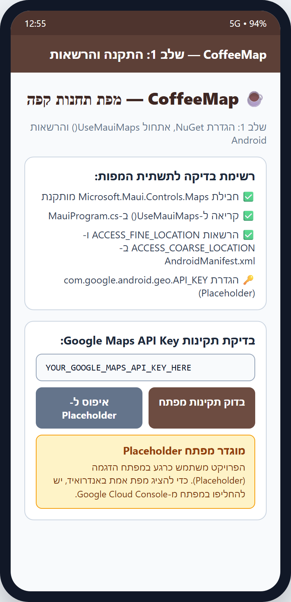

# שלב 1: תשתית, חבילות NuGet והרשאות Android למפות Google

> **פרויקט:** CoffeeMap — מפת תחנות קפה ב-.NET MAUI  
> **ענף Git (Branch):** `stage/01-setup-and-permissions`  
> **קהל יעד:** תלמידים מתחילים בפיתוח אפליקציות מובייל (.NET MAUI)  
> **מקרא צבעים בקוד:** שורות המודגשות ב**רקע ירוק וטקסט צהוב** הן השורות המדויקות שעליכם **להוסיף** לפרויקט.

---

## 1. מה אנחנו בונים בשלב הזה ולמה זה חשוב?

לפני שאפשר להציג מפה על המסך או להוסיף עליה סיכות (`Pins`) של תחנות קפה, צריך לבנות את ה**תשתית** שמחברת בין אפליקציית .NET MAUI שלנו לבין שירותי המפות של מערכת ההפעלה Android (Google Maps SDK).

בשלב הזה נלמד וניישם 4 אבני יסוד:
1. **התקנת חבילת NuGet** — הוספת `Microsoft.Maui.Controls.Maps` לפרויקט (ב-Visual Studio 2026 או ב-JetBrains Rider ב-Mac).
2. **רישום פקד המפה באתחול** — קריאה ל-`.UseMauiMaps()` בתוך `MauiProgram.cs`.
3. **מנגנון ההרשאות והגדרת ה-API Key ב-Android (`AndroidManifest.xml`)** — איך מערכת ההפעלה מגנה על פרטיות המשתמש ואיפה בדיוק מציבים את המפתח.
4. **הגנה על ה-API Key (`Secrets.props` + `.gitignore`) וארכיטקטורת MVVM** — איך שומרים את המפתח באופן מאובטח מחוץ ל-GitHub, ואיך בנויות השכבות.



---

## 2. מהי חבילת NuGet ואיך מתקינים את `Microsoft.Maui.Controls.Maps`?

כדי לשמור על אפליקציות קלות ומהירות, .NET MAUI אינה כוללת כברירת מחדל את כל היכולות המתקדמות (כמו מפות).  
**NuGet** היא חנות הספריות הרשמית של .NET. כאשר אנו מתקינים את `Microsoft.Maui.Controls.Maps`, אנחנו מוסיפים לפרויקט את פקד ה-`Map`, את מחלקות הנתונים (`Location`, `MapSpan`, `Pin`, `Polyline`, `Circle`) ואת ה-Handlers הטבעיים ל-Google Maps באנדרואיד ול-Apple Maps ב-iOS.

### התקנה ב-Visual Studio 2026 (Windows) — צעד אחר צעד:
1. בחלונית **Solution Explorer**, לחצו **קליק ימני** על פרויקט האפליקציה **`MauiGoogleMapSample`** (שימו לב: על הפרויקט עצמו, **לא** על ה-Solution ולא על פרויקט ה-`Tests`).
2. בחרו בתפריט: **`Manage NuGet Packages...`**.
3. בחלונית שנפתחה, עברו ללשונית **`Browse`** (חיפוש).
4. הקלידו בשורת החיפוש: `Microsoft.Maui.Controls.Maps`.
5. בחרו את החבילה הרשמית של **Microsoft**, בחרו בגרסה היציבה התואמת לגרסת ה-.NET MAUI שלכם, ולחצו **`Install`**.
6. אשרו את חלון הרישיון (**Accept**) והמתינו לסיום ההתקנה.

### התקנה ב-JetBrains Rider (macOS) — צעד אחר צעד:
1. פתחו את חלונית **`NuGet`** בתחתית המסך (או לחצו **קליק ימני** על פרויקט **`MauiGoogleMapSample`** בחלונית **Explorer** ובחרו **`Manage NuGet Packages`**).
2. בשורת החיפוש הקלידו: `Microsoft.Maui.Controls.Maps`.
3. לחצו על החבילה הרשמית של **Microsoft** ברשימת התוצאות.
4. בצד ימין של החלונית, ודאו שהפרויקט **`MauiGoogleMapSample`** מסומן (ולא פרויקט ה-`Tests`), בחרו את הגרסה היציבה התואמת ל-.NET 10, ולחצו על כפתור **`+` (Install)**.

### מה משתנה בקובץ `MauiGoogleMapSample.csproj` לאחר ההתקנה?

```xml
<ItemGroup>
    <PackageReference Include="Microsoft.Maui.Controls" Version="$(MauiVersion)" />
    <PackageReference Include="Microsoft.Extensions.Logging.Debug" Version="10.0.0" />
+   <PackageReference Include="Microsoft.Maui.Controls.Maps" Version="$(MauiVersion)" />
</ItemGroup>
```

---

## 3. אתחול המפות ורישום שכבות ב-`MauiProgram.cs`

הקובץ `MauiProgram.cs` הוא "חדר הבקרה" של האפליקציה — הוא רץ ראשון בעת ההפעלה ובונה את כל השירותים והפקדים.  
כדי שפקד ה-`Map` יעבוד, **חובה** לשרשר את **`.UseMauiMaps()`** ל-`MauiAppBuilder`.  
בנוסף, אנו משתמשים בשיטת **Fluent Builder Extension Methods** (`RegisterServices`, `RegisterViewModels`, `RegisterViews`) כדי לשמור על `CreateMauiApp()` נקי ומאורגן:

```csharp
var builder = MauiApp.CreateBuilder();
builder
    .UseMauiApp<App>()
+   .UseMauiMaps()
+   .RegisterServices()
+   .RegisterViewModels()
+   .RegisterViews()
    .ConfigureFonts(fonts =>
    {
        fonts.AddFont("OpenSans-Regular.ttf", "OpenSansRegular");
        fonts.AddFont("OpenSans-Semibold.ttf", "OpenSansSemibold");
    });
```

> **שימו לב — הבהרה חשובה למתחילים!**  
> בקטע הקוד למטה מופיעים `IMapConfigurationValidator`, `MapConfigurationValidator` ו-`SetupStatusViewModel`.  
> **אלו אינם שירותים מובנים של .NET MAUI או של Google!**  
> אלו מחלקות **שאנחנו יצרנו בעצמנו** בתוך הפרויקט הזה (בתיקיות `Services/` ו-`ViewModels/`).  
> אם תפתחו פרויקט MAUI חדש משלכם — **השורה היחידה שמגיעה מ-.NET MAUI להפעלת מפות היא `.UseMauiMaps()`**, ובתוך `RegisterServices` / `RegisterViewModels` / `RegisterViews` תרשמו אך ורק את המחלקות שאתם תכתבו בפרויקט שלכם!

| רכיב ב-`MauiProgram.cs` | מאיפה הוא מגיע? | תפקיד |
| :--- | :--- | :--- |
| `.UseMauiMaps()` | **מובנה בחבילת `Microsoft.Maui.Controls.Maps`** | מחבר את פקד ה-`Map` למפות Google באנדרואיד / Apple Maps ב-iOS. |
| `IMapConfigurationValidator` / `MapConfigurationValidator` | **מחלקה שכתבנו בעצמנו** (`Services/`) | בודקת תקינות פורמט של מפתח API. |
| `SetupStatusViewModel` | **מחלקה שכתבנו בעצמנו** (`ViewModels/`) | ה-ViewModel של מסך שלב 1 (`MainPage`). |

```csharp
private static MauiAppBuilder RegisterServices(this MauiAppBuilder builder)
{
    builder.Services.AddSingleton<IMapConfigurationValidator, MapConfigurationValidator>();
    return builder;
}

private static MauiAppBuilder RegisterViewModels(this MauiAppBuilder builder)
{
    builder.Services.AddTransient<SetupStatusViewModel>();
    return builder;
}

private static MauiAppBuilder RegisterViews(this MauiAppBuilder builder)
{
    builder.Services.AddTransient<MainPage>();
    return builder;
}
```

---

## 4. מנגנון ההרשאות באנדרואיד — מה מנהלים ואיפה?

מערכת ההפעלה **Android** בנויה סביב אבטחה ופרטיות. אפליקציה **אינה יכולה** להשתמש בחיישני המכשיר (כמו GPS או אינטרנט) ללא הצהרה מפורשת בקובץ:
`MauiGoogleMapSample/Platforms/Android/AndroidManifest.xml`

הקובץ `AndroidManifest.xml` הוא **"תעודת הזהות"** של האפליקציה מול מערכת ההפעלה וחנות Google Play.

### אילו הרשאות יש להוסיף?

| הרשאה (`uses-permission`) | רמת דיוק / תפקיד | למה אפליקציית CoffeeMap צריכה אותה? |
| :--- | :--- | :--- |
| `android.permission.INTERNET` | גישה לרשת האינטרנט | טעינת אריחי המפה משרתי Google Maps. |
| `android.permission.ACCESS_NETWORK_STATE` | בדיקת מצב חיבור רשת | לדעת אם יש אינטרנט זמין לפני טעינת מפה. |
| `android.permission.ACCESS_COARSE_LOCATION` | מיקום משוער (רמת שכונה/רחוב, Wi-Fi/סלולר) | הצגת אזור כללי של המשתמש תוך חיסכון בסוללה. |
| `android.permission.ACCESS_FINE_LOCATION` | מיקום מדויק (GPS לווייני, רמת מטרים) | איתור מדויק של תחנת הקפה הקרובה ביותר למשתמש. |

<div class="alert-important">
<strong>🔑 חובה לשים לב — תגית <code>com.google.android.geo.API_KEY</code>!</strong><br/>
מלבד ההרשאות, <strong>בתוך תגית <code>&lt;application&gt;...&lt;/application&gt;</code></strong> בקובץ <code>AndroidManifest.xml</code> יש להוסיף תגית <code>&lt;meta-data&gt;</code> עם השם המדויק <strong><code>com.google.android.geo.API_KEY</code></strong>.<br/>
במקום להדביק שם את המפתח האמיתי (שעלול להיחשף ב-GitHub!), אנו שמים את המשתנה <strong><code>${GoogleMapsApiKey}</code></strong> — והערך האמיתי מוזרק אוטומטית בזמן Build מקובץ מקומי בשם <code>Secrets.props</code> (שחסום ב-<code>.gitignore</code>).
</div>

### השורות שיש להוסיף ב-`Platforms/Android/AndroidManifest.xml`:

```xml
<?xml version="1.0" encoding="utf-8"?>
<manifest xmlns:android="http://schemas.android.com/apk/res/android">
    <application android:allowBackup="false" android:icon="@mipmap/appicon" android:roundIcon="@mipmap/appicon_round" android:supportsRtl="true">
+       <meta-data android:name="com.google.android.geo.API_KEY" android:value="${GoogleMapsApiKey}" />
    </application>
    <uses-permission android:name="android.permission.ACCESS_NETWORK_STATE" />
    <uses-permission android:name="android.permission.INTERNET" />
+   <uses-permission android:name="android.permission.ACCESS_COARSE_LOCATION" />
+   <uses-permission android:name="android.permission.ACCESS_FINE_LOCATION" />
</manifest>
```

> **חשוב לדעת למתחילים:** הצהרה ב-`AndroidManifest.xml` היא רק **השלב הראשון** (הרשאה ברמת התקנה). עבור הרשאות רגישות כמו מיקום, Android דורשת גם **אישור בזמן ריצה** מהמשתמש (חלון קופץ "האם לאפשר לאפליקציה לגשת למיקום שלך?") — את זה ניישם בשלב 4.

---

## 5. הנפקת Google Maps API Key והגנה עליו באמצעות `Secrets.props` + `.gitignore`

### איך מנפיקים מפתח אמיתי ב-Google Cloud Console?
המדריך הרשמי של Google בעברית: [הגדרת מפתח API ל-Maps SDK for Android](https://developers.google.com/maps/documentation/android-sdk/get-api-key?hl=he)

1. היכנסו ל-[Google Cloud Console](https://console.cloud.google.com/) עם חשבון Google.
2. צרו פרויקט חדש בשם `CoffeeMap-MAUI`.
3. בתפריט הצד עברו ל-**APIs & Services -> Library**, חפשו **Maps SDK for Android** ולחצו **Enable**.
4. עברו ל-**APIs & Services -> Credentials**, לחצו **+ CREATE CREDENTIALS -> API key**, והעתיקו את המפתח (מתחיל ב-`AIza...`).

<div class="alert-security">
<strong>🚨 חובה לקרוא לפני ששומרים את המפתח!</strong><br/>
לעולם אל תדביקו מפתח API אמיתי בקובץ שעולה ל-GitHub! להדרכה מלאה צעד אחר צעד על עבודה עם <code>.gitignore</code>, יצירת קובץ מקומי <code>Secrets.props</code> והזרקה אוטומטית ל-<code>AndroidManifest.xml</code>, פתחו את המדריך הייעודי:<br/>
<strong><a href="01b-Securing-Api-Key-With-Secrets-And-GitIgnore.pdf">01b-Securing-Api-Key-With-Secrets-And-GitIgnore.pdf</a></strong>
</div>

---

## 6. ארכיטקטורת MVVM ומבנה קוד אימות הקונפיגורציה

כדי שהאפליקציה תהיה מסודרת, קריאה וניתנת לבדיקה אוטומטית (Unit Tests), אנו מפרידים את הקוד ל-4 שכבות ברורות (**Vanilla C# MVVM**):

<div class="mvvm-box">
<strong>תרשים שכבות MVVM בשלב 1 (מוזרק דרך <code>MauiProgram.cs</code>):</strong>
<div class="mvvm-flow">
  <div class="mvvm-layer mvvm-view">
    <strong>View (תצוגה)</strong><br/>
    <code>MainPage.xaml</code><br/>
    שדה קלט, כפתורים וטקסטים.<br/>
    מתחבר ב-<code>Binding</code> בלבד.
  </div>
  <div class="mvvm-arrow">⇅</div>
  <div class="mvvm-layer mvvm-vm">
    <strong>ViewModel (מצב ופקודות)</strong><br/>
    <code>SetupStatusViewModel.cs</code><br/>
    <code>INotifyPropertyChanged</code><br/>
    <code>ICommand</code> + <code>CanExecute</code>
  </div>
  <div class="mvvm-arrow">↓</div>
  <div class="mvvm-layer mvvm-svc">
    <strong>Service (לוגיקת אימות)</strong><br/>
    <code>MapConfigurationValidator.cs</code><br/>
    בדיקת תקינות פורמט המפתח<br/>
    והחזרת <code>MapConfigCheckResult</code>.
  </div>
  <div class="mvvm-arrow">↓</div>
  <div class="mvvm-layer mvvm-plat">
    <strong>Build &amp; Platform</strong><br/>
    <code>Secrets.props</code> (מקומי)<br/>
    → <code>AndroidManifest.xml</code><br/>
    הרשאות + הזרקת מפתח.
  </div>
</div>
</div>

### הסבר על קובץ אימות הקונפיגורציה (`Services/MapConfigurationValidator.cs`)

כדי לעזור לתלמידים ולמשתמש לזהות מיד האם מפתח ה-API בפורמט תקין, יצרנו את המחלקה `MapConfigurationValidator` ואת טיפוס התוצאה `MapConfigCheckResult(bool IsValid, string StatusTitle, string Details)`.

המתודה `ValidateApiKey(string? apiKey)` מבצעת **3 בדיקות מדורגות**:
1. **מפתח ריק או רווחים (`string.IsNullOrWhiteSpace`):** מחזירה `IsValid = false` עם הכותרת `"מפתח API חסר"`.
2. **עדיין מוגדר Placeholder (`YOUR_GOOGLE_MAPS_API_KEY_HERE`):** מחזירה `IsValid = false` ומזכירה שצריך להחליפו במפתח מ-Google Cloud Console.
3. **אורך קצר מדי (`trimmed.Length < 20`):** מחזירה `IsValid = false` כי מפתחות Google אמיתיים ארוכים מ-20 תווים.
4. **אחרת:** מחזירה `IsValid = true` (`"פורמט המפתח תקין"`).

```csharp
public MapConfigCheckResult ValidateApiKey(string? apiKey)
{
    if (string.IsNullOrWhiteSpace(apiKey))
        return new MapConfigCheckResult(false, "מפתח API חסר", "...");

    string trimmed = apiKey.Trim();
    if (string.Equals(trimmed, PlaceholderKey, StringComparison.OrdinalIgnoreCase))
        return new MapConfigCheckResult(false, "מוגדר מפתח Placeholder", "...");

    if (trimmed.Length < 20)
        return new MapConfigCheckResult(false, "פורמט מפתח קצר מדי", "...");

    return new MapConfigCheckResult(true, "פורמט המפתח תקין", "...");
}
```

### דיאגרמות מערכת ובדיקות יחידה
* בתיקיית `Docs/` מחכים לכם גם קובצי PDF של הדיאגרמות המלאות של הפרויקט:
  * [`Architecture-Overview.pdf`](Architecture-Overview.pdf) — ארכיטקטורה כללית
  * [`Architecture-UML.pdf`](Architecture-UML.pdf) — דיאגרמת מחלקות (UML)
  * [`Screen-Flow.pdf`](Screen-Flow.pdf) — תרשים זרימת מסכים
* להסבר מלא על הרצת בדיקות היחידה ב-Visual Studio וב-`dotnet test`, ראו [`00-Working-With-Unit-Tests.pdf`](00-Working-With-Unit-Tests.pdf).
* למשימת התרגול שלכם, פתחו את [`Assignments/01-Setup-And-Permissions-Assignment.pdf`](Assignments/01-Setup-And-Permissions-Assignment.pdf)!
