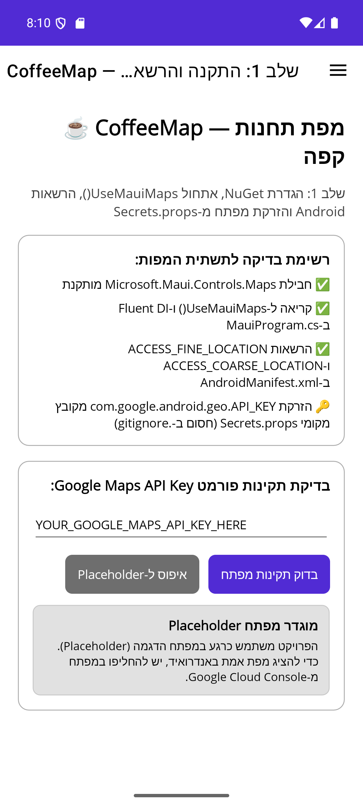

# שלב 2: הצגת מפה, סוגי מפות (`MapType`) ומיקוד אזור (`MapSpan`)

> **פרויקט:** CoffeeMap — מפת תחנות קפה ב-.NET MAUI  
> **ענף Git (Branch):** `stage/02-map-display-and-types`  
> **קהל יעד:** תלמידים מתחילים בפיתוח אפליקציות מובייל (.NET MAUI)  
> **מקרא צבעים בקוד:** שורות המודגשות ב**רקע ירוק וטקסט צהוב** הן שורות חדשות שיש להוסיף לתוך קובץ קיים.

---

## 1. מה אנחנו בונים בשלב הזה? (תצוגת המסך)

לאחר שבשלב 1 הגדרנו את חבילת `Microsoft.Maui.Controls.Maps`, את `.UseMauiMaps()` ואת הרשאות Android, כעת נבנה צעד אחר צעד את מסך **`MapDisplayPage`** שמציג מפה חיה, כפתורים להחלפת סוג המפה (`Street`, `Satellite`, `Hybrid`), כפתורי זום (`+` / `-`) ובחירה בין 3 מוקדי קפה בישראל:



> **שימו לב:** בצילום המסך החי המפה מופיעה ברקע בז' עם לוגו Google מכיוון שהפרויקט רץ עם מפתח ה-Placeholder (`YOUR_GOOGLE_MAPS_API_KEY_HERE`). מיד לאחר שתגדירו מפתח אמיתי בקובץ המקומי `Secrets.props` (ראו מדריך `01b`), אריחי המפה ייטענו במלואם!

> **הערת פלטפורמה:** פקד המפות המובנה של .NET MAUI מציג מפה חיה ב-**Android**, **iOS** ו-**Mac Catalyst** (לא ב-Windows Desktop). את הלוגיקה נבדוק באמצעות בדיקות היחידה ב-`MauiGoogleMapSample.Tests`.

---

## 2. מה מובנה ב-.NET MAUI לעומת מה אנחנו יוצרים בעצמנו?

| רכיב | מאיפה הוא מגיע? | תפקיד |
| :--- | :--- | :--- |
| `<maps:Map>` ו-`CoffeeMapControl.MoveToRegion(span)` | **מובנה ב-`Microsoft.Maui.Controls.Maps`** | פקד המפה הגרפי והמתודה שממקדת אותו על אזור. |
| `MapType`, `Location`, `Distance`, `MapSpan` | **מובנה ב-.NET MAUI (`Microsoft.Maui.Maps`)** | סוגי מפה (`Street`/`Satellite`/`Hybrid`), קואורדינטות וטווח צפייה. |
| `Dispatcher.Dispatch(...)` | **מובנה ב-`ContentPage` (.NET MAUI)** | מתזמן הרצת קוד בבטחה על ה-UI Thread הראשי. |
| `CoffeeRegion` (`Models/CoffeeRegion.cs`) | **מחלקה שיצרנו בעצמנו** | מודל נתונים לאזור קפה. |
| `ICoffeeRegionService` / `CoffeeRegionService` | **מחלקה שיצרנו בעצמנו (`Services/`)** | מספקת את רשימת האזורים ובונה `MapSpan`. |
| `MapDisplayViewModel` + האירוע `MoveToRegionRequested` | **מחלקה ואירוע שיצרנו בעצמנו (`ViewModels/`)** | מנהלת את מצב המסך ומודיעה ל-View מתי להזיז את המפה. |

---

## 3. שלב א' — בניית המודל (`Models`) ושירות האזורים (`Services`)

### 3.1 המודל: `Models/CoffeeRegion.cs`
מחלקת **Model** מייצגת מבנה נתונים טהור (ללא לוגיקת מסך). כל מופע של `CoffeeRegion` מתאר אזור גיאוגרפי אחד שבו נרצה למקד את המפה:

| מאפיין (`Property`) | טיפוס | הסבר וערכים לדוגמה |
| :--- | :--- | :--- |
| `Name` | `string` | שם האזור שיוצג על הכפתור ובפס הסיכום (למשל `"תל אביב — רוטשילד"`). |
| `Description` | `string` | תיאור קצר של אזור בתי הקפה. |
| `Latitude` | `double` | **קו רוחב** (צפון/דרום). בישראל הערכים נעים בין `29.5` (אילת) ל-`33.3` (הצפון). |
| `Longitude` | `double` | **קו אורך** (מזרח/מערב). בישראל הערכים נעים בין `34.2` ל-`35.9`. |
| `DefaultRadiusKm` | `double` | רדיוס הזום ההתחלתי בקילומטרים (למשל `1.2` ק"מ = זום קרוב לרחובות). |

```csharp
namespace MauiGoogleMapSample.Models;

/// <summary>
/// מייצג אזור גיאוגרפי של תחנות קפה על המפה.
/// </summary>
public class CoffeeRegion
{
    public string Name { get; set; } = string.Empty;
    public string Description { get; set; } = string.Empty;
    public double Latitude { get; set; }
    public double Longitude { get; set; }
    public double DefaultRadiusKm { get; set; } = 1.5;
}
```

### 3.2 מהו `MapSpan` ואיך בונים אותו בשירות (`Services/CoffeeRegionService.cs`)?

כדי להזיז את המפה לאזור מסוים, פקד ה-`Map` לא מקבל רק נקודה אחת — הוא צריך לדעת **גם איפה המרכז וגם כמה קרוב להסתכל (רמת הזום)**. לשם כך .NET MAUI מספקת 3 מחלקות שעובדות יחד:

1. **`Location(latitude, longitude)`** — נקודת המרכז המדויקת על כדור הארץ.
2. **`Distance.FromKilometers(radiusKm)`** — המרחק מהמרכז אל קצה המסך (רדיוס קטן יותר = זום קרוב יותר!).
3. **`MapSpan.FromCenterAndRadius(center, distance)`** — יוצר את "חלון המפה" (אזור הצפייה) שאותו נעביר למפה.

בנוסף, אנו מגדירים **ממשק** `Services/ICoffeeRegionService.cs` (כדי שנוכל להזריק את השירות ב-DI ולבדוק אותו ב-Unit Tests):

```csharp
using MauiGoogleMapSample.Models;
using Microsoft.Maui.Maps;

namespace MauiGoogleMapSample.Services;

/// <summary>
/// חוזה לשירות שמספק את אזורי הקפה ובונה עבורם MapSpan למיקוד המפה.
/// </summary>
public interface ICoffeeRegionService
{
    /// <summary>מחזיר את רשימת אזורי ברירת המחדל (תל אביב, ירושלים, חיפה).</summary>
    IReadOnlyList<CoffeeRegion> GetDefaultRegions();

    /// <summary>בונה חלון צפייה (MapSpan) סביב אזור נתון, עם אפשרות לרדיוס זום מותאם.</summary>
    MapSpan BuildMapSpan(CoffeeRegion region, double? overrideRadiusKm = null);
}
```

וכך נראה המימוש המתועד ב-`Services/CoffeeRegionService.cs` (כולל הגבלת רדיוס לטווח בטוח — **Clamping** בין `0.2` ל-`25.0` ק"מ כדי שהמפה לא תקרוס אם הועבר מספר שלילי או אפס):

```csharp
using MauiGoogleMapSample.Models;
using Microsoft.Maui.Devices.Sensors;
using Microsoft.Maui.Maps;

namespace MauiGoogleMapSample.Services;

public class CoffeeRegionService : ICoffeeRegionService
{
    /// <summary>
    /// מחזיר 3 מוקדי קפה מרכזיים בישראל עם הקואורדינטות ורדיוס הזום שלהם.
    /// </summary>
    public IReadOnlyList<CoffeeRegion> GetDefaultRegions()
    {
        return new List<CoffeeRegion>
        {
            new() { Name = "תל אביב — רוטשילד", Description = "שדרת בתי הקפה המרכזית", Latitude = 32.0636, Longitude = 34.7731, DefaultRadiusKm = 1.2 },
            new() { Name = "ירושלים — מחנה יהודה", Description = "תחנות קפה סביב השוק", Latitude = 31.7850, Longitude = 35.2124, DefaultRadiusKm = 1.5 },
            new() { Name = "חיפה — המושבה הגרמנית", Description = "בתי קפה מול הגנים הבהאיים", Latitude = 32.8191, Longitude = 34.9912, DefaultRadiusKm = 1.8 }
        };
    }

    /// <summary>
    /// יוצר אובייקט MapSpan ממורכז על קואורדינטות האזור ומוגן מפני רדיוס חריג.
    /// </summary>
    public MapSpan BuildMapSpan(CoffeeRegion region, double? overrideRadiusKm = null)
    {
        ArgumentNullException.ThrowIfNull(region);

        // אם לא הועבר רדיוס זום מפורש — נשתמש ברדיוס ברירת המחדל של האזור
        double radiusKm = overrideRadiusKm ?? region.DefaultRadiusKm;

        // Clamping: מונע זום קטן מדי (קריסה/מסך ריק) או רחוק מדי
        if (radiusKm < 0.2) radiusKm = 0.2;
        else if (radiusKm > 25.0) radiusKm = 25.0;

        // יצירת נקודת המרכז וחלון הצפייה (MapSpan)
        var center = new Location(region.Latitude, region.Longitude);
        return MapSpan.FromCenterAndRadius(center, Distance.FromKilometers(radiusKm));
    }
}
```

<div class="alert-important">
<strong>💡 תחביר C# למתחילים — מה זה האופרטור <code>??</code>?</strong><br/>
האופרטור <code>??</code> נקרא <strong>Null-Coalescing Operator</strong> (אופרטור ברירת מחדל ל-<code>null</code>).<br/>
השורה <code>double radiusKm = overrideRadiusKm ?? region.DefaultRadiusKm;</code> שקולה בדיוק ל:<br/>
<code>double radiusKm;</code><br/>
<code>if (overrideRadiusKm != null) radiusKm = overrideRadiusKm.Value; else radiusKm = region.DefaultRadiusKm;</code><br/>
כלומר: <em>"אם קיבלנו רדיוס מותאם (<code>overrideRadiusKm</code>) — השתמש בו; אחרת (אם הוא <code>null</code>) — קח את ברירת המחדל של האזור."</em>
</div>

---

## 4. שלב ב' — בניית ה-ViewModel שלב אחר שלב (`ViewModels/MapDisplayViewModel.cs`)

נבנה את `MapDisplayViewModel` ב-**5 צעדים קטנים וברורים** (בשיטת Vanilla C# MVVM — ללא Source Generators):

### צעד 1: הגדרת המחלקה, השדות והבנאי (`Constructor`)
המחלקה יורשת מ-`BaseViewModel` (שמממשת `INotifyPropertyChanged`), מקבלת את `ICoffeeRegionService` בהזרקת תלויות (DI), וטוענת את רשימת האזורים ל-`ObservableCollection<CoffeeRegion>`:

```csharp
public class MapDisplayViewModel : BaseViewModel
{
    private const double MinZoomRadiusKm = 0.25;
    private const double MaxZoomRadiusKm = 20.0;

    private readonly ICoffeeRegionService _regionService;
    private MapType _selectedMapType = MapType.Street;
    private CoffeeRegion _selectedRegion;
    private double _zoomRadiusKm;
    private string _regionSummary = string.Empty;

    public ObservableCollection<CoffeeRegion> Regions { get; }

    public MapDisplayViewModel(ICoffeeRegionService regionService)
    {
        _regionService = regionService;
        Title = "CoffeeMap — שלב 2: תצוגת מפה";

        Regions = new ObservableCollection<CoffeeRegion>(_regionService.GetDefaultRegions());
        _selectedRegion = Regions[0];
        _zoomRadiusKm = _selectedRegion.DefaultRadiusKm;

        // אתחול הפקודות (יוסבר בצעד 3)
        _setMapTypeCommand = new Command<string>(ExecuteSetMapType);
        _selectRegionCommand = new Command<CoffeeRegion>(ExecuteSelectRegion, CanExecuteSelectRegion);
        _zoomInCommand = new Command(ExecuteZoomIn, CanExecuteZoomIn);
        _zoomOutCommand = new Command(ExecuteZoomOut, CanExecuteZoomOut);

        UpdateRegionSummary();
    }
}
```

### צעד 2: טבלת כל ה-Properties ב-`MapDisplayViewModel` והשימוש בהם

לפני כתיבת ה-Setters, להלן מיפוי מלא של כל מאפיין ב-ViewModel ולמה הוא משמש במסך:

| מאפיין (`Property`) | טיפוס | תפקיד ושימוש ב-XAML / לוגיקה |
| :--- | :--- | :--- |
| `Title` (מורש מ-`BaseViewModel`) | `string` | כותרת הדף בסרגל העליון (`Title="{Binding Title}"`). |
| `Regions` | `ObservableCollection<CoffeeRegion>` | רשימת ערי הקפה — מחובר ל-`FlexLayout` (`BindableLayout.ItemsSource`). |
| `SelectedMapType` | `MapType` | סוג התצוגה הפעיל (`Street`/`Satellite`/`Hybrid`) — מחובר ל-`<maps:Map MapType="{Binding SelectedMapType}">`. |
| `SelectedRegion` | `CoffeeRegion` | העיר הנבחרת כרגע (משמשת לבניית ה-`MapSpan` ולפס הסיכום). |
| `ZoomRadiusKm` | `double` | רדיוס הזום הנוכחי בק"מ — מפעיל `ChangeCanExecute()` על כפתורי `+`/`-` כשמשתנה. |
| `RegionSummary` | `string` | שורת הסיכום בתחתית המסך (`Label Text="{Binding RegionSummary}"`). |

לכל מאפיין שהמסך קשור אליו (`Binding`) יש שדה פרטי ו-Setter מפורש בן 3 שורות:

```csharp
public MapType SelectedMapType
{
    get => _selectedMapType;
    set
    {
        if (_selectedMapType == value) return;
        _selectedMapType = value;
        OnPropertyChanged();
        UpdateRegionSummary();
    }
}

public double ZoomRadiusKm
{
    get => _zoomRadiusKm;
    set
    {
        if (Math.Abs(_zoomRadiusKm - value) < 0.001) return;
        _zoomRadiusKm = value;
        OnPropertyChanged();
        _zoomInCommand.ChangeCanExecute();
        _zoomOutCommand.ChangeCanExecute();
        UpdateRegionSummary();
    }
}
```

### צעד 3: הגדרת הפקודות (`ICommand`) ותנאי `CanExecute`
כל כפתור במסך מחובר לפקודה (`ICommand`):
* `SetMapTypeCommand` — מקבלת מחרוזת (`"Street"`, `"Satellite"`, `"Hybrid"`), ממירה אותה ל-`enum MapType` ומעדכנת את `SelectedMapType`.
* `ZoomInCommand` — מקטינה את הרדיוס פי `1.5`, ופעילה (`CanExecute`) רק כל עוד `ZoomRadiusKm > MinZoomRadiusKm`.
* `ZoomOutCommand` — מגדילה את הרדיוס פי `1.5`, ופעילה רק כל עוד `ZoomRadiusKm < MaxZoomRadiusKm`.

```csharp
private bool CanExecuteZoomIn() => ZoomRadiusKm > MinZoomRadiusKm;

private void ExecuteZoomIn()
{
    ZoomRadiusKm = Math.Max(MinZoomRadiusKm, Math.Round(ZoomRadiusKm / 1.5, 2));
    RequestMapMove();
}
```

### צעד 4: ה-Event שלנו להזזת המפה (`MoveToRegionRequested`)
פקד ה-`<maps:Map>` **אינו** תומך ב-Binding ישיר ל-`MoveToRegion`.  
מכיוון שאסור ל-ViewModel להחזיק הפניה לפקד הגרפי, **אנחנו יוצרים בעצמנו Event ב-ViewModel**:

```csharp
// Event שיצרנו בעצמנו (לא של פקד המפה!)
public event Action<MapSpan>? MoveToRegionRequested;

public MapSpan GetCurrentMapSpan()
{
    return _regionService.BuildMapSpan(SelectedRegion, ZoomRadiusKm);
}

private void RequestMapMove()
{
    MapSpan span = GetCurrentMapSpan();
    // האופרטור ?. אומר: הפעל Invoke רק אם מישהו נרשם לאירוע (לא null) — מונע NullReferenceException
    MoveToRegionRequested?.Invoke(span);
}
```

### צעד 5: עדכון פס המידע בעברית (`UpdateRegionSummary`)
בכל שינוי של עיר, סוג מפה או רדיוס, המתודה בונה מחרוזת סיכום קריאה ומעדכנת את `RegionSummary`:
`"תל אביב — רוטשילד | תצוגה: רחובות (Street) | רדיוס: 1.2 ק\"מ"`.

---

## 5. שלב ג' — בניית ה-XAML שלב אחר שלב (`Views/MapDisplayPage.xaml`)

נבנה את המסך ב-**4 צעדים מסודרים**:

### צעד 1: הגדרת כותרת ה-`ContentPage` ומרחבי השמות (`xmlns`)
כדי להשתמש בפקד `<maps:Map>` וב-Compiled Bindings (`x:DataType`), מוסיפים בראש הדף 3 הצהרות `xmlns`:
* `xmlns:maps` — מאפשר לכתוב `<maps:Map>`.
* `xmlns:models` — מאפשר לציין `x:DataType="models:CoffeeRegion"` בתוך רשימת הערים.
* `xmlns:vm` — מאפשר לציין `x:DataType="vm:MapDisplayViewModel"` על כל הדף.

```xml
<ContentPage xmlns="http://schemas.microsoft.com/dotnet/2021/maui"
             xmlns:x="http://schemas.microsoft.com/winfx/2009/xaml"
+            xmlns:maps="http://schemas.microsoft.com/dotnet/2021/maui/maps"
+            xmlns:models="clr-namespace:MauiGoogleMapSample.Models"
+            xmlns:vm="clr-namespace:MauiGoogleMapSample.ViewModels"
             x:Class="MauiGoogleMapSample.Views.MapDisplayPage"
+            x:DataType="vm:MapDisplayViewModel"
+            FlowDirection="RightToLeft"
             Title="{Binding Title}">
```

### צעד 2: חלוקת המסך ל-4 שורות עם `Grid`
```xml
<Grid RowDefinitions="Auto,Auto,*,Auto" RowSpacing="8" Padding="12">
    <!-- Row 0 (Auto): כפתורי סוג מפה וזום -->
    <!-- Row 1 (Auto): רשימת ערים אופקית -->
    <!-- Row 2 (*):    המפה — תופסת את כל השטח הפנוי במסך! -->
    <!-- Row 3 (Auto): פס סיכום המצב הנוכחי -->
</Grid>
```

### צעד 3: שורת הכפתורים (`Row 0`) ורשימת הערים (`Row 1`)
שימו לב: בתוך `CollectionView`, ההקשר (`BindingContext`) של כל פריט הוא `CoffeeRegion`, אבל הפקודה `SelectRegionCommand` נמצאת ב-`MapDisplayViewModel` — לכן משתמשים ב-`RelativeSource AncestorType` כדי "לטפס" חזרה ל-ViewModel:

```xml
<!-- Row 0: סוגי מפה וזום -->
<HorizontalStackLayout Grid.Row="0" Spacing="8" HorizontalOptions="Center">
    <Button Text="רחובות" Command="{Binding SetMapTypeCommand}" CommandParameter="Street" />
    <Button Text="לוויין" Command="{Binding SetMapTypeCommand}" CommandParameter="Satellite" />
    <Button Text="משולב" Command="{Binding SetMapTypeCommand}" CommandParameter="Hybrid" />
    <Button Text="+" WidthRequest="44" Command="{Binding ZoomInCommand}" />
    <Button Text="-" WidthRequest="44" Command="{Binding ZoomOutCommand}" />
</HorizontalStackLayout>

<!-- Row 1: בחירת עיר (FlexLayout עם Wrap=Wrap כדי שאף עיר לא תיחתך בצד המסך!) -->
<FlexLayout Grid.Row="1" BindableLayout.ItemsSource="{Binding Regions}" Wrap="Wrap" JustifyContent="Center">
    <BindableLayout.ItemTemplate>
        <DataTemplate x:DataType="models:CoffeeRegion">
            <Button Text="{Binding Name}" Margin="4,3" Padding="10,6" FontSize="12"
                    Command="{Binding Source={RelativeSource AncestorType={x:Type vm:MapDisplayViewModel}}, Path=SelectRegionCommand}"
                    CommandParameter="{Binding .}" />
        </DataTemplate>
    </BindableLayout.ItemTemplate>
</FlexLayout>
```

### צעד 4: הצבת פקד המפה (`Row 2`) ופס הסיכום (`Row 3`)
נותנים למפה `x:Name="CoffeeMapControl"` כדי שנוכל לקרוא ל-`MoveToRegion` מתוך `MapDisplayPage.xaml.cs`:

```xml
<Border Grid.Row="2" StrokeShape="RoundRectangle 12" Stroke="{StaticResource Gray300}">
    <maps:Map x:Name="CoffeeMapControl"
              MapType="{Binding SelectedMapType}"
              IsScrollEnabled="True"
              IsZoomEnabled="True" />
</Border>

<Border Grid.Row="3" StrokeShape="RoundRectangle 8" Padding="10" BackgroundColor="{StaticResource Gray100}">
    <Label Text="{Binding RegionSummary}" FontSize="13" FontAttributes="Bold" HorizontalTextAlignment="Center" />
</Border>
```

---

## 6. שלב ד' — בניית ה-Code-Behind שלב אחר שלב (`Views/MapDisplayPage.xaml.cs`)

נבנה את `MapDisplayPage.xaml.cs` ב-**4 צעדים ברורים**:

### צעד 1: הבנאי (`Constructor`) וחיבור ה-`BindingContext`
הדף מקבל את `MapDisplayViewModel` אוטומטית ממנגנון ה-DI (שרשמנו ב-`MauiProgram.cs`) ושומר אותו בשדה `_viewModel`:

```csharp
private readonly MapDisplayViewModel _viewModel;

public MapDisplayPage(MapDisplayViewModel viewModel)
{
    InitializeComponent();
    _viewModel = viewModel;
    BindingContext = _viewModel;
}
```

### צעד 2: מה זה `Dispatcher.Dispatch(...)` ולמה משתמשים בו כאן?

<div class="alert-important">
<strong>💡 מושג חדש למתחילים — מה זה <code>Dispatcher</code>?</strong><br/>
באפליקציות מובייל (Android / iOS), קיים <strong>חוט ריצה ראשי אחד בלבד שמותר לו לגעת בפקדי המסך</strong> — הוא נקרא <strong>UI Thread</strong> (Main Thread).<br/>
בנוסף, ברגע שבו <code>OnAppearing()</code> מתחיל לרוץ, פקד המפה הטבעי של אנדרואיד עדיין מסיים להיטען על המסך.<br/>
הפקודה <code>Dispatcher.Dispatch(() =&gt; ...)</code> היא הדרך של .NET MAUI לומר למערכת ההפעלה:<br/>
<em>"הכניסי את הפעולה הזו לתור העבודה של ה-UI Thread, והריצי אותה בבטחה מיד כשהמסך והפקד מוכנים!"</em><br/>
כך אנחנו מונעים קריסות תזמון (Race Conditions) ושגיאות גישה לממשק המשתמש מחוט ריצה אחר.
</div>

### צעד 3: הרשמה לאירוע ב-`OnAppearing()` וביטול הרשמה ב-`OnDisappearing()`
* כשהדף מופיע (`OnAppearing`), נרשמים לאירוע שיצרנו ב-ViewModel (`+=`) וממקדים את המפה על העיר הראשונה.
* כשהמשתמש עוזב את הדף (`OnDisappearing`), **חובה** לבטל את ההרשמה (`-=`) כדי שהאירוע לא ישאיר את הדף תקוע בזיכרון (מניעת **Memory Leak**).

### צעד 4: הקוד המלא של `Views/MapDisplayPage.xaml.cs`
```csharp
using MauiGoogleMapSample.ViewModels;
using Microsoft.Maui.Maps;

namespace MauiGoogleMapSample.Views;

public partial class MapDisplayPage : ContentPage
{
    private readonly MapDisplayViewModel _viewModel;

    public MapDisplayPage(MapDisplayViewModel viewModel)
    {
        InitializeComponent();
        _viewModel = viewModel;
        BindingContext = _viewModel;
    }

    protected override void OnAppearing()
    {
        base.OnAppearing();
        _viewModel.MoveToRegionRequested += OnMoveToRegionRequested;
        Dispatcher.Dispatch(() => SafeMoveToRegion(_viewModel.GetCurrentMapSpan()));
    }

    protected override void OnDisappearing()
    {
        _viewModel.MoveToRegionRequested -= OnMoveToRegionRequested;
        base.OnDisappearing();
    }

    private void OnMoveToRegionRequested(MapSpan span)
    {
        Dispatcher.Dispatch(() => SafeMoveToRegion(span));
    }

    private void SafeMoveToRegion(MapSpan span)
    {
        try
        {
            CoffeeMapControl?.MoveToRegion(span);
        }
        catch (Exception ex)
        {
            System.Diagnostics.Debug.WriteLine($"[CoffeeMap] MoveToRegion skipped: {ex.Message}");
        }
    }
}
```

---

## 7. שלב ה' — מה מוסיפים ב-`MauiProgram.cs` וב-`AppShell.xaml`?

### בתוך `MauiProgram.cs` (השורות המודגשות מתווספות לקוד הקיים משלב 1):
```csharp
private static MauiAppBuilder RegisterServices(this MauiAppBuilder builder)
{
    builder.Services.AddSingleton<IMapConfigurationValidator, MapConfigurationValidator>();
+   builder.Services.AddSingleton<ICoffeeRegionService, CoffeeRegionService>();
    return builder;
}

private static MauiAppBuilder RegisterViewModels(this MauiAppBuilder builder)
{
    builder.Services.AddTransient<SetupStatusViewModel>();
+   builder.Services.AddTransient<MapDisplayViewModel>();
    return builder;
}

private static MauiAppBuilder RegisterViews(this MauiAppBuilder builder)
{
    builder.Services.AddTransient<MainPage>();
+   builder.Services.AddTransient<MapDisplayPage>();
    return builder;
}
```

### בתוך `AppShell.xaml` (הוספת פריט בתפריט ה-Flyout):
```xml
    <FlyoutItem Title="שלב 1: הגדרות והרשאות" Icon="icon_setup.png">
        <ShellContent Title="שלב 1: הגדרות והרשאות" ContentTemplate="{DataTemplate local:MainPage}" Route="MainPage" />
    </FlyoutItem>
+   <FlyoutItem Title="שלב 2: תצוגת מפה וסוגים" Icon="icon_map.png">
+       <ShellContent Title="שלב 2: תצוגת מפה" ContentTemplate="{DataTemplate views:MapDisplayPage}" Route="MapDisplayPage" />
+   </FlyoutItem>
```

---

## 8. אימות ובדיקות
בצעו **Build** והריצו את הבדיקות ב-Visual Studio (`Test -> Test Explorer -> Run All Tests`) או בטרמינל (`dotnet build` ואז `dotnet test`).  
למשימת התרגול שלכם, פתחו את [`Assignments/02-Map-Display-Assignment.pdf`](Assignments/02-Map-Display-Assignment.pdf).
