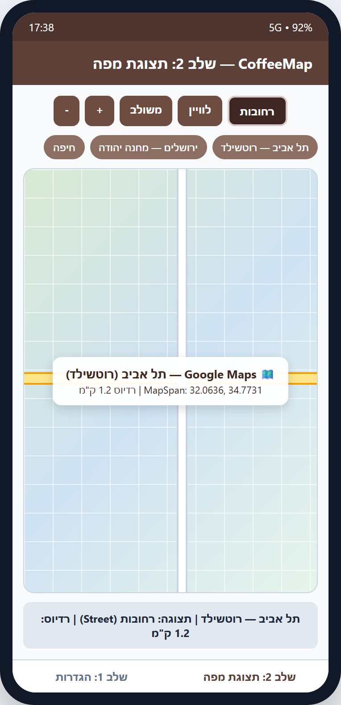

# שלב 2: הצגת מפה, סוגי מפות (`MapType`) ומיקוד אזור (`MapSpan`)

> **פרויקט:** CoffeeMap — מפת תחנות קפה ב-.NET MAUI  
> **ענף Git (Branch):** `stage/02-map-display-and-types`  
> **קהל יעד:** תלמידים מתחילים בפיתוח אפליקציות מובייל (.NET MAUI)  
> **מקרא צבעים בקוד:** שורות המודגשות ב**רקע ירוק וטקסט צהוב** הן שורות חדשות שיש להוסיף לתוך קובץ קיים.

---

## 1. מה אנחנו בונים בשלב הזה? (תצוגת המסך)

לאחר שבשלב 1 הגדרנו את חבילת `Microsoft.Maui.Controls.Maps`, את `.UseMauiMaps()` ואת הרשאות Android, כעת נבנה את מסך **`MapDisplayPage`** שמציג מפה חיה, כפתורים להחלפת סוג המפה (`Street`, `Satellite`, `Hybrid`), כפתורי זום (`+` / `-`) ובחירה בין 3 מוקדי קפה בישראל:



> **הערת פלטפורמה:** פקד המפות המובנה של .NET MAUI מציג מפה חיה ב-**Android**, **iOS** ו-**Mac Catalyst** (לא ב-Windows Desktop).

---

## 2. מה מובנה ב-.NET MAUI לעומת מה אנחנו יוצרים בעצמנו?

לפני שכותבים קוד, חשוב להבדיל בין מה שמגיע מוכן מ-.NET MAUI לבין מה שאנחנו בונים בפרויקט:

| רכיב | מאיפה הוא מגיע? | תפקיד |
| :--- | :--- | :--- |
| `<maps:Map>` ו-`CoffeeMapControl.MoveToRegion(span)` | **מובנה ב-`Microsoft.Maui.Controls.Maps`** | פקד המפה הגרפי והמתודה שממקדת אותו על אזור. |
| `MapType`, `Location`, `Distance`, `MapSpan` | **מובנה ב-.NET MAUI (`Microsoft.Maui.Maps`)** | סוגי מפה (`Street`/`Satellite`/`Hybrid`), קואורדינטות וטווח צפייה. |
| `CoffeeRegion` (`Models/CoffeeRegion.cs`) | **מחלקה שיצרנו בעצמנו** | מודל נתונים לאזור קפה (שם, תיאור, `Latitude`, `Longitude`, רדיוס). |
| `CoffeeRegionService` (`Services/CoffeeRegionService.cs`) | **מחלקה שיצרנו בעצמנו** | מחזירה את 3 האזורים ובונה `MapSpan.FromCenterAndRadius(...)`. |
| `MoveToRegionRequested` (בתוך `MapDisplayViewModel.cs`) | **Event שיצרנו בעצמנו!** | אירוע C# רגיל שה-ViewModel מפעיל כדי לבקש מה-View להזיז את המפה (לא Event של פקד ה-Map!). |

---

## 3. שלב א' — הגדרת ה-Model וה-Service

### 3.1 המודל (`Models/CoffeeRegion.cs`)
ניצור מחלקת נתונים פשוטה שמייצגת אזור על המפה:

```csharp
namespace MauiGoogleMapSample.Models;

public class CoffeeRegion
{
    public string Name { get; set; } = string.Empty;
    public string Description { get; set; } = string.Empty;
    public double Latitude { get; set; }
    public double Longitude { get; set; }
    public double DefaultRadiusKm { get; set; } = 1.5;
}
```

### 3.2 בניית `MapSpan` בשירות (`Services/CoffeeRegionService.cs`)
כדי להגיד למפה **איפה להתמקד וכמה קרוב לעשות זום**, משתמשים ב-`Location(lat, lon)` וב-`MapSpan.FromCenterAndRadius`:

```csharp
public MapSpan BuildMapSpan(CoffeeRegion region, double? overrideRadiusKm = null)
{
    double radiusKm = overrideRadiusKm ?? region.DefaultRadiusKm;
    if (radiusKm < 0.2) radiusKm = 0.2;
    else if (radiusKm > 25.0) radiusKm = 25.0;

    var center = new Location(region.Latitude, region.Longitude);
    return MapSpan.FromCenterAndRadius(center, Distance.FromKilometers(radiusKm));
}
```

---

## 4. שלב ב' — ה-ViewModel וה-Event שלנו (`ViewModels/MapDisplayViewModel.cs`)

### למה צריך Event משלנו (`MoveToRegionRequested`)?
פקד ה-`<maps:Map>` **אינו** תומך ב-Binding ישיר למיקוד (`MoveToRegion` היא מתודה בקוד ולא Property).  
מכיוון שבארכיטקטורת **MVVM** אסור ל-ViewModel להכיר את פקד ה-`Map` הגרפי (כדי שנוכל לבדוק את ה-ViewModel ב-Unit Tests), אנחנו **יוצרים בעצמנו Event ב-`MapDisplayViewModel.cs`**:

```csharp
public class MapDisplayViewModel : BaseViewModel
{
    // Event שיצרנו בעצמנו (לא חלק מפקד ה-Map!) כדי להודיע לדף מתי להזיז את המפה
    public event Action<MapSpan>? MoveToRegionRequested;

    public MapSpan GetCurrentMapSpan()
    {
        return _regionService.BuildMapSpan(SelectedRegion, ZoomRadiusKm);
    }

    private void ExecuteSelectRegion(CoffeeRegion? region)
    {
        if (region is null) return;
        SelectedRegion = region;
        ZoomRadiusKm = region.DefaultRadiusKm;
        RequestMapMove();
    }

    private void ExecuteZoomIn()
    {
        ZoomRadiusKm = Math.Max(0.25, Math.Round(ZoomRadiusKm / 1.5, 2));
        RequestMapMove();
    }

    // כאן ה-ViewModel "משדר" את האירוע עם ה-MapSpan החדש
    private void RequestMapMove()
    {
        MapSpan span = GetCurrentMapSpan();
        MoveToRegionRequested?.Invoke(span);
    }
}
```

---

## 5. שלב ג' — דף ה-XAML (`Views/MapDisplayPage.xaml`)

1. בראש הדף מוסיפים את מרחב השמות `xmlns:maps="http://schemas.microsoft.com/dotnet/2021/maui/maps"`.
2. נותנים לפקד המפה שם (`x:Name="CoffeeMapControl"`) כדי שנוכל לקרוא לו מה-Code-Behind (`MapDisplayPage.xaml.cs`), ומחברים את `MapType` ב-Binding:

```xml
<ContentPage xmlns="http://schemas.microsoft.com/dotnet/2021/maui"
             xmlns:x="http://schemas.microsoft.com/winfx/2009/xaml"
             xmlns:maps="http://schemas.microsoft.com/dotnet/2021/maui/maps"
             xmlns:vm="clr-namespace:MauiGoogleMapSample.ViewModels"
             x:Class="MauiGoogleMapSample.Views.MapDisplayPage"
             x:DataType="vm:MapDisplayViewModel"
             FlowDirection="RightToLeft">

    <!-- שורת כפתורים לסוג מפה וזום -->
    <HorizontalStackLayout Grid.Row="0" Spacing="8" HorizontalOptions="Center">
        <Button Text="רחובות" Command="{Binding SetMapTypeCommand}" CommandParameter="Street" />
        <Button Text="לוויין" Command="{Binding SetMapTypeCommand}" CommandParameter="Satellite" />
        <Button Text="משולב" Command="{Binding SetMapTypeCommand}" CommandParameter="Hybrid" />
        <Button Text="+" WidthRequest="44" Command="{Binding ZoomInCommand}" />
        <Button Text="-" WidthRequest="44" Command="{Binding ZoomOutCommand}" />
    </HorizontalStackLayout>

    <!-- פקד המפה הטבעי -->
    <maps:Map x:Name="CoffeeMapControl"
              Grid.Row="2"
              MapType="{Binding SelectedMapType}"
              IsScrollEnabled="True"
              IsZoomEnabled="True" />
</ContentPage>
```

---

## 6. שלב ד' — חיבור המיקוד בקובץ `Views/MapDisplayPage.xaml.cs` (ה-Code-Behind)

כאן נסגר המעגל! בקובץ **`Views/MapDisplayPage.xaml.cs`**:
1. ב-`OnAppearing()` (כשהמסך עולה) אנו **נרשמים** לאירוע `_viewModel.MoveToRegionRequested` וגם מבצעים מיקוד ראשוני על תל אביב.
2. ב-`OnDisappearing()` (כשעוזבים את המסך) אנו **מבטלים רישום** (`-=`) כדי למנוע דליפות זיכרון!
3. בתוך `SafeMoveToRegion(span)` אנו קוראים למתודה המובנית `CoffeeMapControl.MoveToRegion(span)` דרך `Dispatcher.Dispatch` (בטוח לאנדרואיד):

```csharp
using MauiGoogleMapSample.ViewModels;
using Microsoft.Maui.Maps;

namespace MauiGoogleMapSample.Views;

public partial class MapDisplayPage : ContentPage
{
    private readonly MapDisplayViewModel _viewModel;

    public MapDisplayPage(MapDisplayViewModel viewModel)
    {
        InitializeComponent();
        _viewModel = viewModel;
        BindingContext = _viewModel;
    }

    protected override void OnAppearing()
    {
        base.OnAppearing();
        // 1. הרשמה לאירוע שיצרנו ב-ViewModel
        _viewModel.MoveToRegionRequested += OnMoveToRegionRequested;
        // 2. מיקוד ראשוני של המפה בעליית המסך
        Dispatcher.Dispatch(() => SafeMoveToRegion(_viewModel.GetCurrentMapSpan()));
    }

    protected override void OnDisappearing()
    {
        // ביטול הרשמה בעת יציאה מהמסך (חובה למניעת דליפות זיכרון!)
        _viewModel.MoveToRegionRequested -= OnMoveToRegionRequested;
        base.OnDisappearing();
    }

    private void OnMoveToRegionRequested(MapSpan span)
    {
        Dispatcher.Dispatch(() => SafeMoveToRegion(span));
    }

    private void SafeMoveToRegion(MapSpan span)
    {
        try
        {
            CoffeeMapControl?.MoveToRegion(span);
        }
        catch (Exception ex)
        {
            System.Diagnostics.Debug.WriteLine($"[CoffeeMap] MoveToRegion skipped: {ex.Message}");
        }
    }
}
```

---

## 7. שלב ה' — מה מוסיפים ב-`MauiProgram.cs` וב-`AppShell.xaml`?

### בתוך `MauiProgram.cs` (השורות המודגשות מתווספות לקוד הקיים משלב 1):
```csharp
private static MauiAppBuilder RegisterServices(this MauiAppBuilder builder)
{
    builder.Services.AddSingleton<IMapConfigurationValidator, MapConfigurationValidator>();
+   builder.Services.AddSingleton<ICoffeeRegionService, CoffeeRegionService>();
    return builder;
}

private static MauiAppBuilder RegisterViewModels(this MauiAppBuilder builder)
{
    builder.Services.AddTransient<SetupStatusViewModel>();
+   builder.Services.AddTransient<MapDisplayViewModel>();
    return builder;
}

private static MauiAppBuilder RegisterViews(this MauiAppBuilder builder)
{
    builder.Services.AddTransient<MainPage>();
+   builder.Services.AddTransient<MapDisplayPage>();
    return builder;
}
```

### בתוך `AppShell.xaml` (הוספת פריט בתפריט ה-Flyout):
```xml
    <FlyoutItem Title="שלב 1: הגדרות והרשאות" Icon="icon_setup.png">
        <ShellContent Title="שלב 1: הגדרות והרשאות" ContentTemplate="{DataTemplate local:MainPage}" Route="MainPage" />
    </FlyoutItem>
+   <FlyoutItem Title="שלב 2: תצוגת מפה וסוגים" Icon="icon_map.png">
+       <ShellContent Title="שלב 2: תצוגת מפה" ContentTemplate="{DataTemplate views:MapDisplayPage}" Route="MapDisplayPage" />
+   </FlyoutItem>
```

---

## 8. אימות ובדיקות
בצעו **Build** והריצו את הבדיקות ב-Visual Studio (`Test -> Test Explorer -> Run All Tests`) או בטרמינל (`dotnet build` ואז `dotnet test`).  
למשימת התרגול שלכם, פתחו את [`Assignments/02-Map-Display-Assignment.pdf`](Assignments/02-Map-Display-Assignment.pdf).
