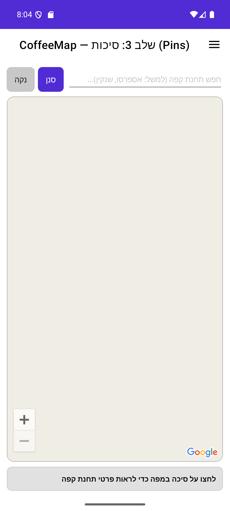

# שלב 3: סיכות על המפה (`Pins`), קישור נתונים ואירועי לחיצה

> **פרויקט:** CoffeeMap — מפת תחנות קפה ב-.NET MAUI  
> **ענף Git (Branch):** `stage/03-pins-and-callouts`  
> **קהל יעד:** תלמידים מתחילים בפיתוח אפליקציות מובייל (.NET MAUI)  
> **מקרא צבעים בקוד:** שורות המודגשות ב**רקע ירוק וטקסט צהוב** הן שורות חדשות שיש להוסיף לתוך קובץ קיים.

---

## 1. מה אנחנו בונים בשלב הזה? (תצוגת המסך)

בשלב זה נבנה את מסך **`CoffeePinsPage`** שמציג תחנות קפה על המפה כסיכות (`Pins`), מאפשר לסנן אותן בזמן אמת משורת חיפוש, ומגיב ללחיצה על סיכה או על בועת המידע שלה:



---

## 2. מה מובנה ב-.NET MAUI לעומת מה אנחנו יוצרים בעצמנו?

| רכיב | מאיפה הוא מגיע? | תפקיד |
| :--- | :--- | :--- |
| `<maps:Pin>` (`Location`, `Label`, `Address`, `Type`) | **מובנה ב-`Microsoft.Maui.Controls.Maps`** | סמן ("נעץ") המוצג על המפה ובועת המידע מעליו. |
| `MarkerClicked` ו-`InfoWindowClicked` | **Events מובנים של `<maps:Pin>`!** | מופעלים אוטומטית כשהמשתמש לוחץ על הסיכה או על הבועה. |
| `DisplayAlertAsync(...)` | **מתודה מובנית ב-`ContentPage` (.NET 10 MAUI)** | מציגה חלון התראה אסינכרוני למשתמש. |
| `CoffeeStation`, `CoffeeStationService`, `CoffeePinsViewModel` | **מחלקות שיצרנו בעצמנו** | נתוני תחנות הקפה, הסינון, וניהול הסיכה הנבחרת. |

---

## 3. שלב א' — מודל תחנת קפה (`Models/CoffeeStation.cs`)

שימו לב למאפיין המחושב `Location` — הוא ממיר את `Latitude` ו-`Longitude` לאובייקט `Location` שפקד ה-`<maps:Pin>` מצפה לקבל:

```csharp
using Microsoft.Maui.Devices.Sensors;

namespace MauiGoogleMapSample.Models;

public class CoffeeStation
{
    public string Id { get; set; } = string.Empty;
    public string Name { get; set; } = string.Empty;
    public string Address { get; set; } = string.Empty;
    public string Specialty { get; set; } = string.Empty;
    public double Rating { get; set; }
    public double Latitude { get; set; }
    public double Longitude { get; set; }

    // מאפיין מחושב (ראו הסבר על התחביר => בתיבה מתחת לקוד)
    public Location Location => new Location(Latitude, Longitude);
}
```

<div class="alert-important">
<strong>💡 תחביר C# למתחילים — מה זה <code>=&gt;</code> במאפיין?</strong><br/>
השורה <code>public Location Location =&gt; new Location(Latitude, Longitude);</code> היא קיצור של מאפיין לקריאה בלבד (<code>get</code>):<br/>
<code>public Location Location { get { return new Location(Latitude, Longitude); } }</code>.
</div>

---

## 4. שלב ב' — ממשק השירות וה-ViewModel (`CoffeePinsViewModel.cs`)

### ממשק השירות (`Services/ICoffeeStationService.cs`)
```csharp
/// <summary>חוזה לשירות שמספק את תחנות הקפה ומאפשר סינון לפי מילת חיפוש.</summary>
public interface ICoffeeStationService
{
    IReadOnlyList<CoffeeStation> GetStations();
    IReadOnlyList<CoffeeStation> FilterStations(string? query);
}
```

### טבלת ה-Properties ב-`CoffeePinsViewModel` והשימוש בהם
| מאפיין (`Property`) | טיפוס | תפקיד ושימוש ב-XAML / לוגיקה |
| :--- | :--- | :--- |
| `Stations` | `ObservableCollection<CoffeeStation>` | רשימת התחנות — מחובר ל-`<maps:Map ItemsSource="{Binding Stations}">`. |
| `SearchQuery` | `string` | מילת החיפוש שהוקלדה ב-`Entry` — מפעילה `ClearFilterCommand.ChangeCanExecute()`. |
| `SelectedStation` | `CoffeeStation?` | תחנת הקפה האחרונה שנלחצה על המפה. |
| `SelectedStationBanner` | `string` | טקסט פס המידע בתחתית המסך (`Label Text="{Binding SelectedStationBanner}"`). |

כאשר המשתמש לוחץ על "סנן", אנו מנקים וטוענים מחדש את `Stations` — ומכיוון שהמפה קשורה אליו ב-`ItemsSource`, הסיכות על המפה מתעדכנות אוטומטית!

```csharp
public ObservableCollection<CoffeeStation> Stations { get; }

private void ExecuteFilter()
{
    IReadOnlyList<CoffeeStation> filtered = _stationService.FilterStations(SearchQuery);
    Stations.Clear();
    foreach (CoffeeStation station in filtered)
    {
        Stations.Add(station);
    }
}

private void ExecuteSelectStationByName(string? stationName)
{
    CoffeeStation? found = Stations.FirstOrDefault(s =>
        string.Equals(s.Name, stationName, StringComparison.OrdinalIgnoreCase));
    if (found is not null)
    {
        SelectedStation = found;
    }
}
```

---

## 5. שלב ג' — קישור הסיכות ב-XAML (`Views/CoffeePinsPage.xaml`)

במקום לולאת `foreach` ידנית בקוד, מחברים את המפה ל-`ItemsSource="{Binding Stations}"` ומגדירים תבנית `DataTemplate` עם `<maps:Pin>` ושני ה-Events המובנים `MarkerClicked` ו-`InfoWindowClicked`:

```xml
<maps:Map x:Name="PinsMapControl"
          Grid.Row="1"
          ItemsSource="{Binding Stations}"
          IsScrollEnabled="True"
          IsZoomEnabled="True">
    <maps:Map.ItemTemplate>
        <DataTemplate x:DataType="models:CoffeeStation">
            <maps:Pin Location="{Binding Location}"
                      Label="{Binding Name}"
                      Address="{Binding Address}"
                      Type="Place"
                      MarkerClicked="OnPinMarkerClicked"
                      InfoWindowClicked="OnPinInfoWindowClicked" />
        </DataTemplate>
    </maps:Map.ItemTemplate>
</maps:Map>
```

---

## 6. שלב ד' — טיפול באירועי לחיצה ומיקוד ב-`Views/CoffeePinsPage.xaml.cs`

כאן נמצאים שני ה-Event Handlers של ה-`Pin` (`OnPinMarkerClicked` ו-`OnPinInfoWindowClicked`) והמיקוד הראשוני ב-`OnAppearing()`:

```csharp
using MauiGoogleMapSample.ViewModels;
using Microsoft.Maui.Controls.Maps;

namespace MauiGoogleMapSample.Views;

public partial class CoffeePinsPage : ContentPage
{
    private readonly CoffeePinsViewModel _viewModel;

    public CoffeePinsPage(CoffeePinsViewModel viewModel)
    {
        InitializeComponent();
        _viewModel = viewModel;
        BindingContext = _viewModel;
    }

    protected override void OnAppearing()
    {
        base.OnAppearing();
        Dispatcher.Dispatch(() =>
        {
            PinsMapControl?.MoveToRegion(_viewModel.GetInitialMapSpan());
        });
    }

    // לחיצה על הסיכה עצמה -> if (sender is Pin pin) בודק אם sender הוא מסוג Pin ושומר אותו במשתנה pin
    private void OnPinMarkerClicked(object? sender, PinClickedEventArgs e)
    {
        if (sender is Pin pin)
        {
            _viewModel.SelectStationByNameCommand.Execute(pin.Label);
        }
    }

    // לחיצה על הבועה שמעל הסיכה -> מציגה חלון פרטים מלא (DisplayAlertAsync)
    private async void OnPinInfoWindowClicked(object? sender, PinClickedEventArgs e)
    {
        if (sender is Pin pin)
        {
            _viewModel.SelectStationByNameCommand.Execute(pin.Label);
            await DisplayAlertAsync(
                pin.Label,
                $"כתובת: {pin.Address}\n{_viewModel.SelectedStationBanner}",
                "סגור");
        }
    }
}
```

---

## 7. שלב ה' — מה מוסיפים ב-`MauiProgram.cs` וב-`AppShell.xaml`?

```csharp
private static MauiAppBuilder RegisterServices(this MauiAppBuilder builder)
{
    builder.Services.AddSingleton<IMapConfigurationValidator, MapConfigurationValidator>();
    builder.Services.AddSingleton<ICoffeeRegionService, CoffeeRegionService>();
+   builder.Services.AddSingleton<ICoffeeStationService, CoffeeStationService>();
    return builder;
}

private static MauiAppBuilder RegisterViewModels(this MauiAppBuilder builder)
{
    builder.Services.AddTransient<SetupStatusViewModel>();
    builder.Services.AddTransient<MapDisplayViewModel>();
+   builder.Services.AddTransient<CoffeePinsViewModel>();
    return builder;
}

private static MauiAppBuilder RegisterViews(this MauiAppBuilder builder)
{
    builder.Services.AddTransient<MainPage>();
    builder.Services.AddTransient<MapDisplayPage>();
+   builder.Services.AddTransient<CoffeePinsPage>();
    return builder;
}
```

### בתוך `AppShell.xaml` (הוספת שלב 3 לתפריט ה-Flyout):
```xml
    <FlyoutItem Title="שלב 2: תצוגת מפה וסוגים" Icon="icon_map.png">
        <ShellContent Title="שלב 2: תצוגת מפה" ContentTemplate="{DataTemplate views:MapDisplayPage}" Route="MapDisplayPage" />
    </FlyoutItem>
+   <FlyoutItem Title="שלב 3: סיכות (Pins)" Icon="icon_pins.png">
+       <ShellContent Title="שלב 3: סיכות" ContentTemplate="{DataTemplate views:CoffeePinsPage}" Route="CoffeePinsPage" />
+   </FlyoutItem>
```

---

## 8. אימות ובדיקות
בצעו **Build** והריצו את כל הבדיקות ב-Visual Studio (`Test -> Test Explorer -> Run All Tests`) או בטרמינל (`dotnet build` ו-`dotnet test`).  
למשימת התרגול שלכם, פתחו את [`Assignments/03-Pins-And-Callouts-Assignment.pdf`](Assignments/03-Pins-And-Callouts-Assignment.pdf).
