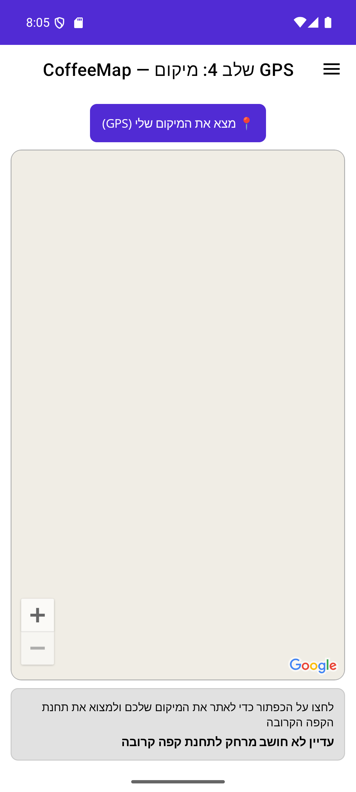

# שלב 4: מיקום המשתמש (GPS), הרשאות בזמן ריצה וחישוב מרחקים

> **פרויקט:** CoffeeMap — מפת תחנות קפה ב-.NET MAUI  
> **ענף Git (Branch):** `stage/04-gps-and-user-location`  
> **קהל יעד:** תלמידים מתחילים בפיתוח אפליקציות מובייל (.NET MAUI)  
> **מקרא צבעים בקוד:** שורות המודגשות ב**רקע ירוק וטקסט צהוב** הן שורות חדשות שיש להוסיף לתוך קובץ קיים.

---

## 1. מה אנחנו בונים בשלב הזה? (תצוגת המסך)

בשלב זה נבנה את מסך **`UserLocationPage`** שמבקש מהמשתמש הרשאת GPS בזמן ריצה, מציג את הנקודה הכחולה שלו על המפה (`IsShowingUser`), ממקד את המפה עליו, ומחשב איזו תחנת קפה היא הקרובה ביותר:



---

## 2. מה מובנה ב-.NET MAUI לעומת מה אנחנו יוצרים בעצמנו?

| רכיב | מאיפה הוא מגיע? | תפקיד |
| :--- | :--- | :--- |
| `Permissions.CheckStatusAsync` / `RequestAsync<Permissions.LocationWhenInUse>` | **מובנה ב-.NET MAUI (`Microsoft.Maui.ApplicationModel`)** | מבקש אישור מיקום מהמשתמש בחלון קופץ של מערכת ההפעלה. |
| `Geolocation.Default.GetLocationAsync(...)` | **מובנה ב-.NET MAUI (`Microsoft.Maui.Devices.Sensors`)** | קורא את קואורדינטות ה-GPS הנוכחיות מהמכשיר. |
| `Location.CalculateDistance(from, to, DistanceUnits.Kilometers)` | **מובנה ב-.NET MAUI** | מחשב מרחק אווירי מדויק בק"מ בין שתי נקודות. |
| `IsShowingUser` (על `<maps:Map>`) | **מאפיין מובנה של `<maps:Map>`** | מציג את הנקודה הכחולה של המשתמש על המפה. |
| `ILocationService`, `LocationService`, `UserLocationViewModel`, `MoveToRegionRequested` | **מחלקות ואירוע שיצרנו בעצמנו** | מפרידים את חיישן ה-GPS מה-ViewModel כדי שנוכל לבדוק אותו ב-Unit Tests. |

---

## 3. שלב א' — הגדרת הממשק (`ILocationService`) והמחלקה המממשת (`LocationService`)

### 3.1 הגדרת הממשק (`Interface`): `Services/ILocationService.cs`

למה הגדרנו את הממשק `ILocationService` במקום לקרוא ל-`Geolocation` ישירות מתוך ה-ViewModel?  
כי במחשב הפיתוח (ובבדיקות יחידה `xunit.v3`) **אין מקלט GPS אמיתי**! הפרדת החוזה לממשק מאפשרת לנו להריץ באפליקציה את `LocationService` האמיתי, ובבדיקות היחידה להזריק `FakeLocationService` שמדמה GPS תוך שנייה אחת.

| פעולה בממשק | קלט ופלט | למה הפעולה הוגדרה בחוזה? |
| :--- | :--- | :--- |
| `GetCurrentLocationAsync()` | ללא קלט → `Task<LocationFetchResult>` | מבקשת הרשאת מיקום בזמן ריצה, קוראת את ה-GPS ומחזירה תוצאה מסודרת (הצלחה/דחייה/שגיאה). |
| `CalculateDistanceKm(from, to)` | שתי נקודות `Location` → `double` | מחשבת מרחק אווירי בק"מ בין שתי נקודות גיאוגרפיות. |
| `FindNearestStation(userLocation, stations)` | מיקום משתמש + רשימת תחנות → `(CoffeeStation?, double)` | סורקת את תחנות הקפה ומחזירה יחד (כ-Tuple) את התחנה הקרובה ביותר ואת המרחק אליה. |

```csharp
using MauiGoogleMapSample.Models;
using Microsoft.Maui.Devices.Sensors;

namespace MauiGoogleMapSample.Services;

// ראו הסבר על record ו-Tuple בסעיף 3.2 מתחת לקוד
public record LocationFetchResult(bool IsSuccess, bool PermissionGranted, Location? Location, string Message);

/// <summary>חוזה לעבודה עם הרשאות GPS, שליפת מיקום וחישוב מרחק לתחנה הקרובה.</summary>
public interface ILocationService
{
    Task<LocationFetchResult> GetCurrentLocationAsync();
    double CalculateDistanceKm(Location from, Location to);
    (CoffeeStation? Station, double DistanceKm) FindNearestStation(Location userLocation, IEnumerable<CoffeeStation> stations);
}
```

<div class="alert-important">
<strong>💡 תחביר C# למתחילים — מה זה <code>Tuple</code>?</strong><br/>
הטיפוס <strong><code>(CoffeeStation? Station, double DistanceKm)</code></strong> נקרא <strong>Tuple</strong>, ומאפשר למתודה אחת להחזיר <strong>שני ערכים יחד</strong> (גם את התחנה הקרובה וגם את המרחק אליה) בלי ליצור מחלקה נפרדת.
</div>

### 3.2 מה זה `record`? השוואה מול `class`, יתרונות, חסרונות ומתי להשתמש בכל אחד

השורה `public record LocationFetchResult(bool IsSuccess, bool PermissionGranted, Location? Location, string Message);` מגדירה **`record`** — טיפוס מודרני ב-C# המיועד לייצוג **חבילת נתונים בלתי-משתנה (Immutable Data)**, כמו תוצאת קריאה לשירות.  
בשורה אחת זו, הקומפיילר מייצר עבורנו אוטומטית: בנאי, Properties לקריאה בלבד (`init`), השוואה לפי **ערך**, והדפסת `ToString()` קריאה לדיבאג.

| קריטריון השוואה | `record` | `class` |
| :--- | :--- | :--- |
| **מטרה עיקרית** | ייצוג נתונים טהורים / תוצאת פעולה (DTO) | ייצוג ישות עם התנהגות, לוגיקה ומצב משתנה |
| **שינוי ערכים לאחר יצירה** | **Immutable** (לא משתנה — יוצרים עותק חדש עם `with`) | **Mutable** (ניתן לשנות Properties בכל רגע) |
| **השוואה (`==` / `Equals`)** | **לפי ערך (Value Equality):** שני `record`ים עם אותם שדות נחשבים שווים! | **לפי כתובת בזיכרון (Reference Equality):** שווים רק אם זה בדיוק אותו מופע |
| **כמות קוד נדרשת** | שורה אחת (`Positional Record`) | בנאי + Properties מפורשים |
| **התאמה ל-`INotifyPropertyChanged` / `TwoWay Binding`** | לא מתאים (כי הערכים לא משתנים) | מתאים באופן מלא |

* **יתרונות של `record`:**
  1. **קוד קצר ונקי** — חוסך עשרות שורות Boilerplate.
  2. **בטיחות מפני באגים (Immutability)** — ברגע ששירות ה-GPS החזיר `LocationFetchResult`, אף חלק אחר בקוד לא יכול לשנות אותו בטעות.
  3. **מעולה ל-Unit Tests** — השוואה לפי ערך (`Assert.Equal`) והדפסת `ToString()` ברורה אם בדיקה נכשלת.
* **חסרונות ומגבלות של `record`:**
  1. לא מתאים למסכים עם עריכת שדות (`TwoWay Binding`) או ל-`ViewModels` שמעדכנים מצב שוטף.
  2. פחות מתאים למחלקות עם לוגיקה עסקית מורכבת או מודלים של SQLite שדורשים בנאי ריק ו-Setters פתוחים.
* **כלל אצבע — מתי בוחרים במה בפרויקט שלנו?**
  * **בחרו `record`** עבור **תוצאות החזרה משירותים** (`LocationFetchResult`, `MapConfigCheckResult`) או נתוני קריאה בלבד.
  * **בחרו `class`** עבור **`ViewModels`** (`UserLocationViewModel`), **`Services`** (`LocationService`), ומודלים שמתעדכנים או נשמרים במסד נתונים.

### 3.3 המחלקה המממשת את הממשק: `Services/LocationService.cs`

כעת יוצרים את המחלקה **`public class LocationService : ILocationService`** שמממשת את **3 הפעולות** שהוגדרו בממשק:

1. **מימוש פעולה 1 — `GetCurrentLocationAsync()`:** בודקת ומבקשת הרשאת זמן ריצה (`Permissions.LocationWhenInUse`), קוראת ל-`Geolocation.Default.GetLocationAsync(...)` עם timeout של 10 שניות, ומחזירה `LocationFetchResult` בטוח (גם אם המשתמש דחה הרשאה או שהמכשיר לא תומך ב-GPS).
2. **מימוש פעולה 2 — `CalculateDistanceKm(from, to)`:** עוטפת את `Location.CalculateDistance(..., DistanceUnits.Kilometers)` לחישוב המרחק האווירי בין שתי נקודות.
3. **מימוש פעולה 3 — `FindNearestStation(userLocation, stations)`:** עוברת בלולאת `foreach` על כל תחנות הקפה, מחשבת לכל אחת מרחק, שומרת את התחנה בעלת המרחק הקטן ביותר (`minDistance`), ומחזירה Tuple של `(nearest, Math.Round(minDistance, 2))`.

```csharp
using MauiGoogleMapSample.Models;
using Microsoft.Maui.ApplicationModel;
using Microsoft.Maui.Devices.Sensors;

namespace MauiGoogleMapSample.Services;

// תחילת המחלקה המממשת את הממשק ILocationService
public class LocationService : ILocationService
{
    /// <summary>מימוש פעולה 1: בקשת הרשאת זמן ריצה ושליפת מיקום GPS נוכחי.</summary>
    public async Task<LocationFetchResult> GetCurrentLocationAsync()
    {
        try
        {
            PermissionStatus status = await Permissions.CheckStatusAsync<Permissions.LocationWhenInUse>();
            if (status != PermissionStatus.Granted)
            {
                status = await Permissions.RequestAsync<Permissions.LocationWhenInUse>();
            }

            if (status != PermissionStatus.Granted)
            {
                return new LocationFetchResult(false, false, null, "הרשאת מיקום נדחתה.");
            }

            var request = new GeolocationRequest(GeolocationAccuracy.Medium, TimeSpan.FromSeconds(10));
            Location? location = await Geolocation.Default.GetLocationAsync(request);

            if (location is null)
            {
                return new LocationFetchResult(false, true, null, "לא ניתן היה לאתר מיקום GPS כרגע.");
            }

            return new LocationFetchResult(true, true, location, $"מיקום נוכחי: {location.Latitude:0.0000}, {location.Longitude:0.0000}");
        }
        catch (Exception ex)
        {
            return new LocationFetchResult(false, false, null, $"שגיאה בקבלת מיקום: {ex.Message}");
        }
    }

    /// <summary>מימוש פעולה 2: חישוב מרחק אווירי בקילומטרים בין שתי נקודות.</summary>
    public double CalculateDistanceKm(Location from, Location to)
    {
        ArgumentNullException.ThrowIfNull(from);
        ArgumentNullException.ThrowIfNull(to);
        return Location.CalculateDistance(from, to, DistanceUnits.Kilometers);
    }

    /// <summary>מימוש פעולה 3: מוצא את תחנת הקפה הקרובה ביותר למיקום המשתמש.</summary>
    public (CoffeeStation? Station, double DistanceKm) FindNearestStation(Location userLocation, IEnumerable<CoffeeStation> stations)
    {
        CoffeeStation? nearest = null;
        double minDistance = double.MaxValue;

        foreach (CoffeeStation station in stations)
        {
            double distance = CalculateDistanceKm(userLocation, station.Location);
            if (distance < minDistance)
            {
                minDistance = distance;
                nearest = station;
            }
        }

        return nearest is null ? (null, 0) : (nearest, Math.Round(minDistance, 2));
    }
}
```

---

## 4. שלב ב' — עבודה אסינכרונית וטבלת Properties ב-`ViewModels/UserLocationViewModel.cs`

| מאפיין (`Property`) | טיפוס | תפקיד ושימוש ב-XAML / לוגיקה |
| :--- | :--- | :--- |
| `IsLoading` (מורש מ-`BaseViewModel`) | `bool` | מציג `<ActivityIndicator>` ומשבית את `LocateMeCommand` דרך `CanExecute`. |
| `Stations` | `ObservableCollection<CoffeeStation>` | תחנות הקפה המוצגות כסיכות על מפת ה-GPS. |
| `IsShowingUser` | `bool` | מחובר ל-`<maps:Map IsShowingUser="{Binding IsShowingUser}">` (מופעל רק אחרי הרשאה!). |
| `CurrentUserLocation` | `Location?` | קואורדינטות ה-GPS האחרונות שהתקבלו מהמכשיר. |
| `LocationStatus` | `string` | הודעת סטטוס/שגיאה למשתמש בתחתית המסך. |
| `NearestStationSummary` | `string` | שם התחנה הקרובה ביותר והמרחק אליה בק"מ. |

שימו לב ל-4 עקרונות מפתח ב-`ExecuteLocateMeAsync()`:
1. מפעילים `IsLoading = true` (שמפעיל `<ActivityIndicator>` במסך) ומשביתים את הכפתור דרך `CanExecute => !IsLoading`.
2. עוטפים ב-`try / catch / finally` כדי שתמיד נכבה `IsLoading = false` גם אם אירעה שגיאה.
3. מפעילים `IsShowingUser = true` רק אחרי שהתקבלה הרשאה!
4. משדרים את ה-Event שלנו `MoveToRegionRequested?.Invoke(span)` כדי למקד את המפה על המשתמש.

```csharp
public event Action<MapSpan>? MoveToRegionRequested;

public async Task ExecuteLocateMeAsync()
{
    if (IsLoading) return;
    IsLoading = true;
    _locateMeCommand.ChangeCanExecute();
    try
    {
        LocationFetchResult result = await _locationService.GetCurrentLocationAsync();
        if (!result.IsSuccess || result.Location is null)
        {
            IsShowingUser = false;
            LocationStatus = result.Message;
            return;
        }

        IsShowingUser = result.PermissionGranted;
        (CoffeeStation? nearest, double distanceKm) = _locationService.FindNearestStation(result.Location, Stations);
        NearestStationSummary = $"☕ התחנה הקרובה ביותר: {nearest?.Name} (במרחק {distanceKm:0.##} ק\"מ)";

        MapSpan span = MapSpan.FromCenterAndRadius(result.Location, Distance.FromKilometers(2.0));
        MoveToRegionRequested?.Invoke(span);
    }
    finally
    {
        IsLoading = false;
        _locateMeCommand.ChangeCanExecute();
    }
}
```

---

## 5. שלב ג' — חיבור המפה ב-`Views/UserLocationPage.xaml` וב-`Views/UserLocationPage.xaml.cs`

בקובץ **`Views/UserLocationPage.xaml`**:
```xml
<HorizontalStackLayout Grid.Row="0" Spacing="10" HorizontalOptions="Center">
    <Button Text="📍 מצא את המיקום שלי (GPS)" Command="{Binding LocateMeCommand}" />
    <ActivityIndicator IsRunning="{Binding IsLoading}" IsVisible="{Binding IsLoading}" />
</HorizontalStackLayout>

<maps:Map x:Name="GpsMapControl"
          Grid.Row="1"
          IsShowingUser="{Binding IsShowingUser}"
          ItemsSource="{Binding Stations}" />
```

בקובץ **`Views/UserLocationPage.xaml.cs`** (הרשמה ל-`MoveToRegionRequested` וביטול רישום ביציאה):
```csharp
protected override void OnAppearing()
{
    base.OnAppearing();
    _viewModel.MoveToRegionRequested += OnMoveToRegionRequested;
    Dispatcher.Dispatch(() => SafeMoveToRegion(
        MapSpan.FromCenterAndRadius(new Location(32.0636, 34.7731), Distance.FromKilometers(3.0))));
}

protected override void OnDisappearing()
{
    _viewModel.MoveToRegionRequested -= OnMoveToRegionRequested;
    base.OnDisappearing();
}

private void OnMoveToRegionRequested(MapSpan span)
{
    Dispatcher.Dispatch(() => SafeMoveToRegion(span));
}
```

---

## 6. שלב ד' — מה מוסיפים ב-`MauiProgram.cs`?

```csharp
private static MauiAppBuilder RegisterServices(this MauiAppBuilder builder)
{
    builder.Services.AddSingleton<IMapConfigurationValidator, MapConfigurationValidator>();
    builder.Services.AddSingleton<ICoffeeRegionService, CoffeeRegionService>();
    builder.Services.AddSingleton<ICoffeeStationService, CoffeeStationService>();
+   builder.Services.AddSingleton<ILocationService, LocationService>();
    return builder;
}

private static MauiAppBuilder RegisterViewModels(this MauiAppBuilder builder)
{
    builder.Services.AddTransient<SetupStatusViewModel>();
    builder.Services.AddTransient<MapDisplayViewModel>();
    builder.Services.AddTransient<CoffeePinsViewModel>();
+   builder.Services.AddTransient<UserLocationViewModel>();
    return builder;
}

private static MauiAppBuilder RegisterViews(this MauiAppBuilder builder)
{
    builder.Services.AddTransient<MainPage>();
    builder.Services.AddTransient<MapDisplayPage>();
    builder.Services.AddTransient<CoffeePinsPage>();
+   builder.Services.AddTransient<UserLocationPage>();
    return builder;
}
```

### בתוך `AppShell.xaml` (הוספת שלב 4 לתפריט ה-Flyout):
```xml
    <FlyoutItem Title="שלב 3: סיכות (Pins)" Icon="icon_pins.png">
        <ShellContent Title="שלב 3: סיכות" ContentTemplate="{DataTemplate views:CoffeePinsPage}" Route="CoffeePinsPage" />
    </FlyoutItem>
+   <FlyoutItem Title="שלב 4: מיקום GPS" Icon="icon_gps.png">
+       <ShellContent Title="שלב 4: מיקום GPS" ContentTemplate="{DataTemplate views:UserLocationPage}" Route="UserLocationPage" />
+   </FlyoutItem>
```

---

## 7. בדיקת GPS ב-Unit Tests בלי מכשיר אמיתי (`FakeLocationService`)
במחשב הפיתוח אין מקלט GPS אמיתי. בזכות הממשק `ILocationService`, יצרנו ב-`MauiGoogleMapSample.Tests/UserLocationViewModelTests.cs` מחלקת דמה (`FakeLocationService`) שמחזירה מיקום קבוע ליד רחוב שנקין — וכך בודקים ב-2 שניות שה-ViewModel מוצא את `"קליית שנקין"`, מתמודד עם דחיית הרשאה ומאפס את `IsLoading`.

* בצעו **Build** והריצו את הבדיקות ב-Visual Studio (`Test -> Test Explorer -> Run All Tests`) או בטרמינל (`dotnet build` ו-`dotnet test`).
* למשימת התרגול שלכם, פתחו את [`Assignments/04-GPS-And-User-Location-Assignment.pdf`](Assignments/04-GPS-And-User-Location-Assignment.pdf).
