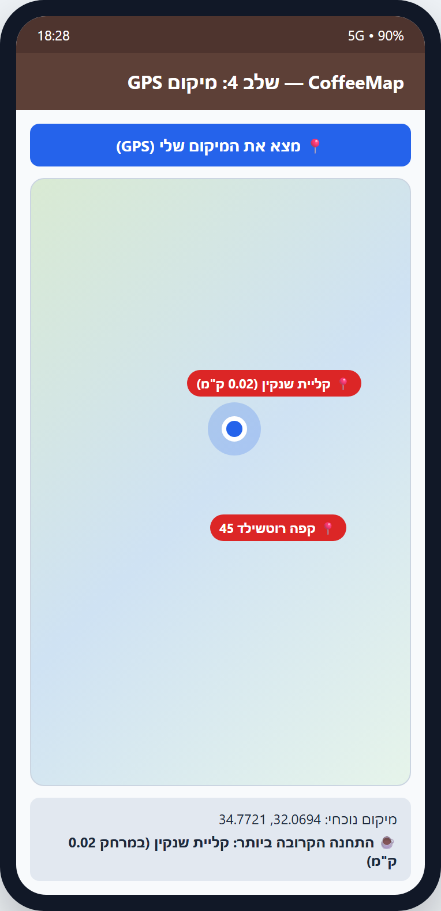

# שלב 4: מיקום המשתמש (GPS), הרשאות בזמן ריצה וחישוב מרחקים

> **פרויקט:** CoffeeMap — מפת תחנות קפה ב-.NET MAUI  
> **ענף Git (Branch):** `stage/04-gps-and-user-location`  
> **קהל יעד:** תלמידים מתחילים בפיתוח אפליקציות מובייל (.NET MAUI)  
> **מקרא צבעים בקוד:** שורות המודגשות ב**רקע ירוק וטקסט צהוב** הן שורות חדשות שיש להוסיף לתוך קובץ קיים.

---

## 1. מה אנחנו בונים בשלב הזה? (תצוגת המסך)

בשלב זה נבנה את מסך **`UserLocationPage`** שמבקש מהמשתמש הרשאת GPS בזמן ריצה, מציג את הנקודה הכחולה שלו על המפה (`IsShowingUser`), ממקד את המפה עליו, ומחשב איזו תחנת קפה היא הקרובה ביותר:



---

## 2. מה מובנה ב-.NET MAUI לעומת מה אנחנו יוצרים בעצמנו?

| רכיב | מאיפה הוא מגיע? | תפקיד |
| :--- | :--- | :--- |
| `Permissions.CheckStatusAsync` / `RequestAsync<Permissions.LocationWhenInUse>` | **מובנה ב-.NET MAUI (`Microsoft.Maui.ApplicationModel`)** | מבקש אישור מיקום מהמשתמש בחלון קופץ של מערכת ההפעלה. |
| `Geolocation.Default.GetLocationAsync(...)` | **מובנה ב-.NET MAUI (`Microsoft.Maui.Devices.Sensors`)** | קורא את קואורדינטות ה-GPS הנוכחיות מהמכשיר. |
| `Location.CalculateDistance(from, to, DistanceUnits.Kilometers)` | **מובנה ב-.NET MAUI** | מחשב מרחק אווירי מדויק בק"מ בין שתי נקודות. |
| `IsShowingUser` (על `<maps:Map>`) | **מאפיין מובנה של `<maps:Map>`** | מציג את הנקודה הכחולה של המשתמש על המפה. |
| `ILocationService`, `LocationService`, `UserLocationViewModel`, `MoveToRegionRequested` | **מחלקות ואירוע שיצרנו בעצמנו** | מפרידים את חיישן ה-GPS מה-ViewModel כדי שנוכל לבדוק אותו ב-Unit Tests. |

---

## 3. שלב א' — שירות המיקום (`Services/LocationService.cs`)

בשלב 1 הצהרנו ב-`AndroidManifest.xml` על הרשאות מיקום, אבל באנדרואיד חובה גם לבקש **הרשאה בזמן ריצה** לפני קריאת ה-GPS:

```csharp
public async Task<LocationFetchResult> GetCurrentLocationAsync()
{
    PermissionStatus status = await Permissions.CheckStatusAsync<Permissions.LocationWhenInUse>();
    if (status != PermissionStatus.Granted)
    {
        status = await Permissions.RequestAsync<Permissions.LocationWhenInUse>();
    }

    if (status != PermissionStatus.Granted)
    {
        return new LocationFetchResult(false, false, null, "הרשאת מיקום נדחתה.");
    }

    var request = new GeolocationRequest(GeolocationAccuracy.Medium, TimeSpan.FromSeconds(10));
    Location? location = await Geolocation.Default.GetLocationAsync(request);
    // ... מחזירים את המיקום שנמצא
}
```

ובאותה מחלקה (`Services/LocationService.cs`) מחשבים את התחנה הקרובה ביותר:

```csharp
public double CalculateDistanceKm(Location from, Location to)
{
    return Location.CalculateDistance(from, to, DistanceUnits.Kilometers);
}
```

---

## 4. שלב ב' — עבודה אסינכרונית ב-`ViewModels/UserLocationViewModel.cs`

שימו לב ל-4 עקרונות מפתח ב-`ExecuteLocateMeAsync()`:
1. מפעילים `IsLoading = true` (שמפעיל `<ActivityIndicator>` במסך) ומשביתים את הכפתור דרך `CanExecute => !IsLoading`.
2. עוטפים ב-`try / catch / finally` כדי שתמיד נכבה `IsLoading = false` גם אם אירעה שגיאה.
3. מפעילים `IsShowingUser = true` רק אחרי שהתקבלה הרשאה!
4. משדרים את ה-Event שלנו `MoveToRegionRequested?.Invoke(span)` כדי למקד את המפה על המשתמש.

```csharp
public event Action<MapSpan>? MoveToRegionRequested;

public async Task ExecuteLocateMeAsync()
{
    if (IsLoading) return;
    IsLoading = true;
    _locateMeCommand.ChangeCanExecute();
    try
    {
        LocationFetchResult result = await _locationService.GetCurrentLocationAsync();
        if (!result.IsSuccess || result.Location is null)
        {
            IsShowingUser = false;
            LocationStatus = result.Message;
            return;
        }

        IsShowingUser = result.PermissionGranted;
        (CoffeeStation? nearest, double distanceKm) = _locationService.FindNearestStation(result.Location, Stations);
        NearestStationSummary = $"☕ התחנה הקרובה ביותר: {nearest?.Name} (במרחק {distanceKm:0.##} ק\"מ)";

        MapSpan span = MapSpan.FromCenterAndRadius(result.Location, Distance.FromKilometers(2.0));
        MoveToRegionRequested?.Invoke(span);
    }
    finally
    {
        IsLoading = false;
        _locateMeCommand.ChangeCanExecute();
    }
}
```

---

## 5. שלב ג' — חיבור המפה ב-`Views/UserLocationPage.xaml` וב-`Views/UserLocationPage.xaml.cs`

בקובץ **`Views/UserLocationPage.xaml`**:
```xml
<HorizontalStackLayout Grid.Row="0" Spacing="10" HorizontalOptions="Center">
    <Button Text="📍 מצא את המיקום שלי (GPS)" Command="{Binding LocateMeCommand}" />
    <ActivityIndicator IsRunning="{Binding IsLoading}" IsVisible="{Binding IsLoading}" />
</HorizontalStackLayout>

<maps:Map x:Name="GpsMapControl"
          Grid.Row="1"
          IsShowingUser="{Binding IsShowingUser}"
          ItemsSource="{Binding Stations}" />
```

בקובץ **`Views/UserLocationPage.xaml.cs`** (הרשמה ל-`MoveToRegionRequested` וביטול רישום ביציאה):
```csharp
protected override void OnAppearing()
{
    base.OnAppearing();
    _viewModel.MoveToRegionRequested += OnMoveToRegionRequested;
    Dispatcher.Dispatch(() => SafeMoveToRegion(
        MapSpan.FromCenterAndRadius(new Location(32.0636, 34.7731), Distance.FromKilometers(3.0))));
}

protected override void OnDisappearing()
{
    _viewModel.MoveToRegionRequested -= OnMoveToRegionRequested;
    base.OnDisappearing();
}

private void OnMoveToRegionRequested(MapSpan span)
{
    Dispatcher.Dispatch(() => SafeMoveToRegion(span));
}
```

---

## 6. שלב ד' — מה מוסיפים ב-`MauiProgram.cs`?

```csharp
private static MauiAppBuilder RegisterServices(this MauiAppBuilder builder)
{
    builder.Services.AddSingleton<IMapConfigurationValidator, MapConfigurationValidator>();
    builder.Services.AddSingleton<ICoffeeRegionService, CoffeeRegionService>();
    builder.Services.AddSingleton<ICoffeeStationService, CoffeeStationService>();
+   builder.Services.AddSingleton<ILocationService, LocationService>();
    return builder;
}

private static MauiAppBuilder RegisterViewModels(this MauiAppBuilder builder)
{
    builder.Services.AddTransient<SetupStatusViewModel>();
    builder.Services.AddTransient<MapDisplayViewModel>();
    builder.Services.AddTransient<CoffeePinsViewModel>();
+   builder.Services.AddTransient<UserLocationViewModel>();
    return builder;
}

private static MauiAppBuilder RegisterViews(this MauiAppBuilder builder)
{
    builder.Services.AddTransient<MainPage>();
    builder.Services.AddTransient<MapDisplayPage>();
    builder.Services.AddTransient<CoffeePinsPage>();
+   builder.Services.AddTransient<UserLocationPage>();
    return builder;
}
```

---

## 7. בדיקת GPS ב-Unit Tests בלי מכשיר אמיתי (`FakeLocationService`)
במחשב הפיתוח אין מקלט GPS אמיתי. בזכות הממשק `ILocationService`, יצרנו ב-`MauiGoogleMapSample.Tests/UserLocationViewModelTests.cs` מחלקת דמה (`FakeLocationService`) שמחזירה מיקום קבוע ליד רחוב שנקין — וכך בודקים ב-2 שניות שה-ViewModel מוצא את `"קליית שנקין"`, מתמודד עם דחיית הרשאה ומאפס את `IsLoading`.

* בצעו **Build** והריצו את הבדיקות ב-Visual Studio (`Test -> Test Explorer -> Run All Tests`) או בטרמינל (`dotnet build` ו-`dotnet test`).
* למשימת התרגול שלכם, פתחו את [`Assignments/04-GPS-And-User-Location-Assignment.pdf`](Assignments/04-GPS-And-User-Location-Assignment.pdf).
