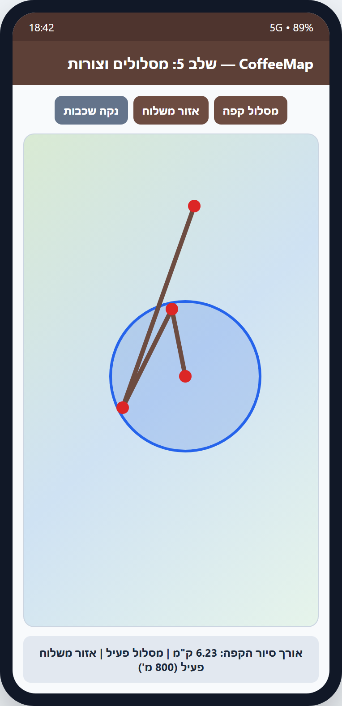

# שלב 5: ציור מסלולים (`Polyline`) וצורות גיאוגרפיות (`Circle` / `Polygon`)

> **פרויקט:** CoffeeMap — מפת תחנות קפה ב-.NET MAUI  
> **ענף Git (Branch):** `stage/05-shapes-and-routes`  
> **קהל יעד:** תלמידים מתחילים בפיתוח אפליקציות מובייל (.NET MAUI)  
> **מקרא צבעים בקוד:** שורות המודגשות ב**רקע ירוק וטקסט צהוב** הן שורות חדשות שיש להוסיף לתוך קובץ קיים.

---

## 1. מה אנחנו בונים בשלב הזה? (תצוגת המסך)

בשלב זה נבנה את מסך **`CoffeeRoutesPage`** שמצייר מעל המפה **מסלול סיור קפה (`Polyline`)** המחבר את כל התחנות, ו**אזור משלוחים (`Circle`)** ברדיוס 800 מטר, עם כפתורי הצגה/הסתרה וניקוי שכבות:



---

## 2. מה מובנה ב-.NET MAUI לעומת מה אנחנו יוצרים בעצמנו?

| רכיב | מאיפה הוא מגיע? | תפקיד |
| :--- | :--- | :--- |
| `Map.MapElements`, `Polyline`, `Circle`, `Polygon` | **מובנה ב-`Microsoft.Maui.Controls.Maps`** | אוסף השכבות הגיאוגרפיות שמצטיירות מעל המפה (`Geopath`, `StrokeColor`, `FillColor`). |
| `ICoffeeRouteService`, `CoffeeRouteService` | **מחלקה שיצרנו בעצמנו (`Services/`)** | בונה את אובייקטי ה-`Polyline` וה-`Circle` ומחשבת את האורך הכולל של הסיור. |
| `CoffeeRoutesViewModel` + האירוע `MapElementsChanged` | **מחלקה ואירוע שיצרנו בעצמנו (`ViewModels/`)** | מנהלת אילו שכבות פעילות ומודיעה לדף מתי לצייר מחדש את `MapElements`. |

---

## 3. שלב א' — בניית הצורות בשירות (`Services/CoffeeRouteService.cs`)

```csharp
public Polyline BuildCoffeeTourPolyline(IEnumerable<CoffeeStation> stations)
{
    var polyline = new Polyline
    {
        StrokeColor = Color.FromArgb("#6D4C41"),
        StrokeWidth = 8
    };

    foreach (CoffeeStation station in stations)
    {
        polyline.Geopath.Add(station.Location);
    }
    return polyline;
}

public Circle BuildDeliveryZoneCircle(Location center, double radiusMeters)
{
    double safeRadius = radiusMeters < 50 ? 50 : radiusMeters;
    return new Circle
    {
        Center = center,
        Radius = Distance.FromMeters(safeRadius),
        StrokeColor = Color.FromArgb("#2563EB"),
        StrokeWidth = 4,
        FillColor = Color.FromArgb("#332563EB") // "33" = שקיפות Alpha
    };
}
```

---

## 4. שלב ב' — ה-ViewModel וה-Event שלנו (`ViewModels/CoffeeRoutesViewModel.cs`)

כיוון ש-`Map.MapElements` מתעדכן בקוד ה-View, יצרנו ב-`CoffeeRoutesViewModel` את האירוע `MapElementsChanged` ואת המתודה `BuildActiveMapElements()`:

```csharp
public event Action? MapElementsChanged;

public IReadOnlyList<MapElement> BuildActiveMapElements()
{
    var elements = new List<MapElement>();

    if (ShowRoute && Stations.Count >= 2)
        elements.Add(_routeService.BuildCoffeeTourPolyline(Stations));

    if (ShowDeliveryZone && Stations.Count > 0)
        elements.Add(_routeService.BuildDeliveryZoneCircle(Stations[0].Location, 800));

    return elements;
}
```

בכל פעם שמשתנה `ShowRoute` או `ShowDeliveryZone` (בלחיצה על הכפתורים), ה-`set` של המאפיין מפעיל `MapElementsChanged?.Invoke();`!

---

## 5. שלב ג' — ציור השכבות בפועל בקובץ `Views/CoffeeRoutesPage.xaml.cs`

בקובץ **`Views/CoffeeRoutesPage.xaml.cs`** אנו מאזינים ל-`MapElementsChanged` ומעדכנים את האוסף המובנה `RoutesMapControl.MapElements`:

```csharp
protected override void OnAppearing()
{
    base.OnAppearing();
    _viewModel.MapElementsChanged += RefreshMapElements;
    Dispatcher.Dispatch(() =>
    {
        RoutesMapControl?.MoveToRegion(_viewModel.GetInitialMapSpan());
        RefreshMapElements();
    });
}

protected override void OnDisappearing()
{
    _viewModel.MapElementsChanged -= RefreshMapElements;
    base.OnDisappearing();
}

private void RefreshMapElements()
{
    Dispatcher.Dispatch(() =>
    {
        if (RoutesMapControl is null) return;
        RoutesMapControl.MapElements.Clear();
        foreach (MapElement element in _viewModel.BuildActiveMapElements())
        {
            RoutesMapControl.MapElements.Add(element);
        }
    });
}
```

---

## 6. שלב ד' — מה מוסיפים ב-`MauiProgram.cs`?

```csharp
private static MauiAppBuilder RegisterServices(this MauiAppBuilder builder)
{
    builder.Services.AddSingleton<IMapConfigurationValidator, MapConfigurationValidator>();
    builder.Services.AddSingleton<ICoffeeRegionService, CoffeeRegionService>();
    builder.Services.AddSingleton<ICoffeeStationService, CoffeeStationService>();
    builder.Services.AddSingleton<ILocationService, LocationService>();
+   builder.Services.AddSingleton<ICoffeeRouteService, CoffeeRouteService>();
    return builder;
}

private static MauiAppBuilder RegisterViewModels(this MauiAppBuilder builder)
{
    builder.Services.AddTransient<SetupStatusViewModel>();
    builder.Services.AddTransient<MapDisplayViewModel>();
    builder.Services.AddTransient<CoffeePinsViewModel>();
    builder.Services.AddTransient<UserLocationViewModel>();
+   builder.Services.AddTransient<CoffeeRoutesViewModel>();
    return builder;
}

private static MauiAppBuilder RegisterViews(this MauiAppBuilder builder)
{
    builder.Services.AddTransient<MainPage>();
    builder.Services.AddTransient<MapDisplayPage>();
    builder.Services.AddTransient<CoffeePinsPage>();
    builder.Services.AddTransient<UserLocationPage>();
+   builder.Services.AddTransient<CoffeeRoutesPage>();
    return builder;
}
```

---

## 7. אימות ובדיקות
בצעו **Build** והריצו את כל הבדיקות ב-Visual Studio (`Test -> Test Explorer -> Run All Tests`) או בטרמינל (`dotnet build` ו-`dotnet test`).  
למשימת הסיום שלכם (ציור `Polygon` למתחם הקפה), פתחו את [`Assignments/05-Shapes-And-Routes-Assignment.pdf`](Assignments/05-Shapes-And-Routes-Assignment.pdf).
