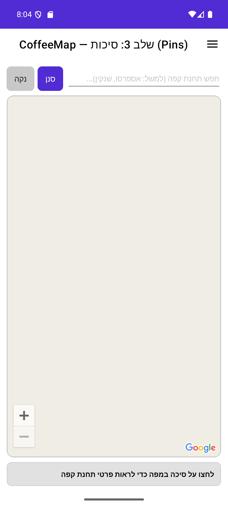

# שלב 3: סיכות על המפה (`CoffeePinsPage`)

בפרק זה אנו מתעדים את השלב השלישי (`stage/03-pins-and-callouts`) — הצגת תחנות קפה כסיכות (`Pin`) באמצעות `ItemsSource` ו-`ItemTemplate` וטיפול באירועי לחיצה.

## 1. תצוגת המסך (Android Mockup)

## 2. רכיבי השלב
* **`Models/CoffeeStation.cs`** — מודל תחנת קפה עם `Location` מחושב.
* **`Services/CoffeeStationService.cs`** — מאגר תחנות קפה וסינון לפי שם/כתובת/התמחות.
* **`ViewModels/CoffeePinsViewModel.cs`** — `ObservableCollection<CoffeeStation>`, פקודות סינון וניקוי עם `CanExecute`, ופס מידע נבחר.
* **`Views/CoffeePinsPage.xaml`** — קישור `ItemsSource="{Binding Stations}"` ו-`DataTemplate` של `<maps:Pin>` עם `MarkerClicked` ו-`InfoWindowClicked` (`DisplayAlertAsync`).
