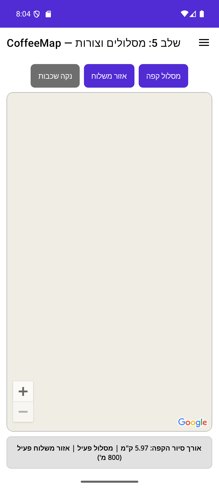

# שלב 5: ציור מסלולים וצורות גיאוגרפיות (`CoffeeRoutesPage`)

בפרק זה אנו מתעדים את השלב החמישי (`stage/05-shapes-and-routes`) — ציור `Polyline` (מסלול סיור תחנות קפה) ו-`Circle` (אזור משלוח) מעל `Map.MapElements`.

## 1. תצוגת המסך (Android Mockup)

## 2. רכיבי השלב
* **`Services/ICoffeeRouteService.cs` ו-`CoffeeRouteService.cs`** — בניית `Polyline`, `Circle` וחישוב אורך מסלול כולל (`CalculateTotalTourDistanceKm`).
* **`ViewModels/CoffeeRoutesViewModel.cs`** — שליטה בהצגה/הסתרה של שכבות, פקודת `ClearOverlaysCommand` עם `CanExecute`, ואירוע `MapElementsChanged`.
* **`Views/CoffeeRoutesPage.xaml`** — הצגת המפה עם הסיכות ורענון `RoutesMapControl.MapElements`.
