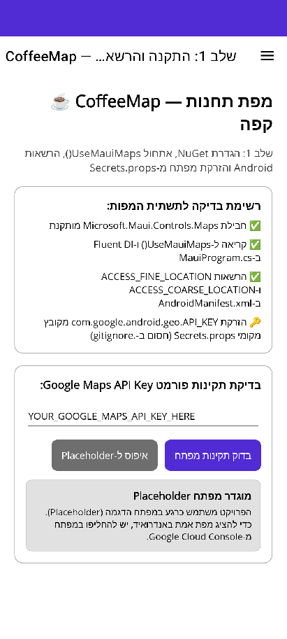

# שלב 1: התקנת מפות, הרשאות Android ואימות תצורה (`MainPage`)

במדריך זה אנו מתעדים את השלב הראשון (`stage/01-setup-and-permissions`) בבניית אפליקציית **CoffeeMap** (איתור תחנות קפה ב-.NET MAUI).

## 1. תצוגת המסך (Android Mockup)

## 2. רכיבי התשתית שהוקמו

1. **חבילת NuGet:** הותקנה `Microsoft.Maui.Controls.Maps` עם `Version="$(MauiVersion)"` בקובץ `MauiGoogleMapSample.csproj`.
2. **אתחול `MauiProgram.cs`:** נוספה קריאה ל-`.UseMauiMaps()` ורישום DI עבור `IMapConfigurationValidator`, `SetupStatusViewModel` ו-`MainPage`.
3. **הרשאות Android (`Platforms/Android/AndroidManifest.xml`):**
   * `ACCESS_COARSE_LOCATION` — מיקום משוער.
   * `ACCESS_FINE_LOCATION` — מיקום מדויק (GPS).
   * `<meta-data android:name="com.google.android.geo.API_KEY" android:value="YOUR_GOOGLE_MAPS_API_KEY_HERE" />`.

## 3. ארכיטקטורת Vanilla C# MVVM

* **`Services/MapConfigurationValidator.cs`**: בודק האם מפתח API ריק, Placeholder, קצר מדי, או תקין.
* **`ViewModels/SetupStatusViewModel.cs`**: מממש `INotifyPropertyChanged` ו-`ICommand` מפורש עם `CanExecute` ו-`ChangeCanExecute()`.
* **`MainPage.xaml`**: משתמש ב-`FlowDirection="RightToLeft"` וב-`x:DataType="vm:SetupStatusViewModel"`.

## 4. קבצי PDF ומטלות לתלמיד

* מדריך מפורט למתחילים: `MauiGoogleMapSample/Docs/01-Setup-And-Permissions.pdf`
* משימת תרגול לתלמיד: `MauiGoogleMapSample/Docs/Assignments/01-Setup-And-Permissions-Assignment.pdf`
