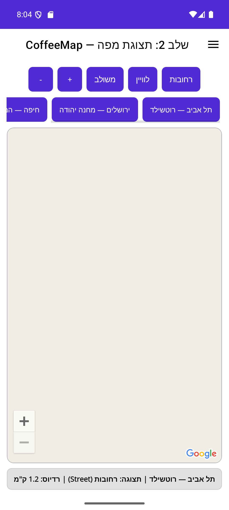

# שלב 2: הצגת מפה, סוגי מפות ומיקוד אזור (`MapDisplayPage`)

בפרק זה אנו מתעדים את השלב השני (`stage/02-map-display-and-types`) באפליקציית **CoffeeMap**.

## 1. תצוגת המסך (Android Mockup)

## 2. ארכיטקטורת Vanilla C# MVVM

* **Model (`Models/CoffeeRegion.cs`):** מייצג אזור קפה (`Name`, `Description`, `Latitude`, `Longitude`, `DefaultRadiusKm`).
* **Service (`Services/CoffeeRegionService.cs`):** מספק אזורי קפה מרכזיים בישראל ובונה `MapSpan.FromCenterAndRadius(...)` עם הגבלת רדיוס בטוחה.
* **ViewModel (`ViewModels/MapDisplayViewModel.cs`):** מנהל את `SelectedMapType` (`Street`/`Satellite`/`Hybrid`), את `SelectedRegion`, את `ZoomRadiusKm`, ופקודות `ICommand` עם `CanExecute` (`ZoomInCommand`, `ZoomOutCommand`, `SetMapTypeCommand`, `SelectRegionCommand`).
* **View (`Views/MapDisplayPage.xaml`):** מציג את `<maps:Map>` ומחבר את אירוע `MoveToRegionRequested` למתודה `CoffeeMapControl.MoveToRegion(span)`.
* **Fluent DI (`MauiProgram.cs`):** רישום נקי בתוך `RegisterServices()`, `RegisterViewModels()` ו-`RegisterViews()`.

## 3. מסמכי PDF לתלמיד
* מדריך שלב 2: `MauiGoogleMapSample/Docs/02-Map-Display-And-Types.pdf`
* משימת שלב 2: `MauiGoogleMapSample/Docs/Assignments/02-Map-Display-Assignment.pdf`
