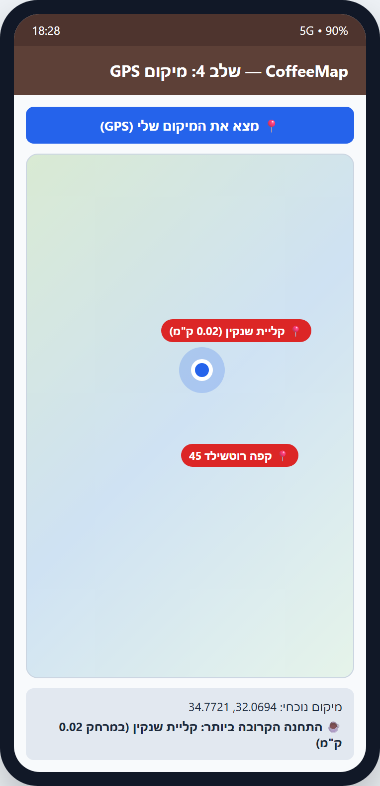

# שלב 4: מיקום המשתמש וחישוב מרחקים (`UserLocationPage`)

בפרק זה אנו מתעדים את השלב הרביעי (`stage/04-gps-and-user-location`) — בקשת הרשאות מיקום בזמן ריצה, שליפת מיקום GPS באמצעות `Geolocation`, ומציאת תחנת הקפה הקרובה ביותר.

## 1. תצוגת המסך (Android Mockup)

## 2. רכיבי השלב
* **`Services/ILocationService.cs` ו-`LocationService.cs`** — בקשת `Permissions.LocationWhenInUse`, קריאת `Geolocation.Default.GetLocationAsync`, וחישוב מרחקים (`Location.CalculateDistance`).
* **`ViewModels/UserLocationViewModel.cs`** — ניהול `IsLoading`, `IsShowingUser`, `LocateMeCommand` אסינכרוני עם `CanExecute` ו-`try/catch/finally`.
* **`Views/UserLocationPage.xaml`** — הצגת הנקודה הכחולה (`IsShowingUser="{Binding IsShowingUser}"`) ו-`ActivityIndicator`.
* **`MauiGoogleMapSample.Tests/UserLocationViewModelTests.cs`** — בדיקות יחידה עם `FakeLocationService` ללא תלות בחומרת GPS.
